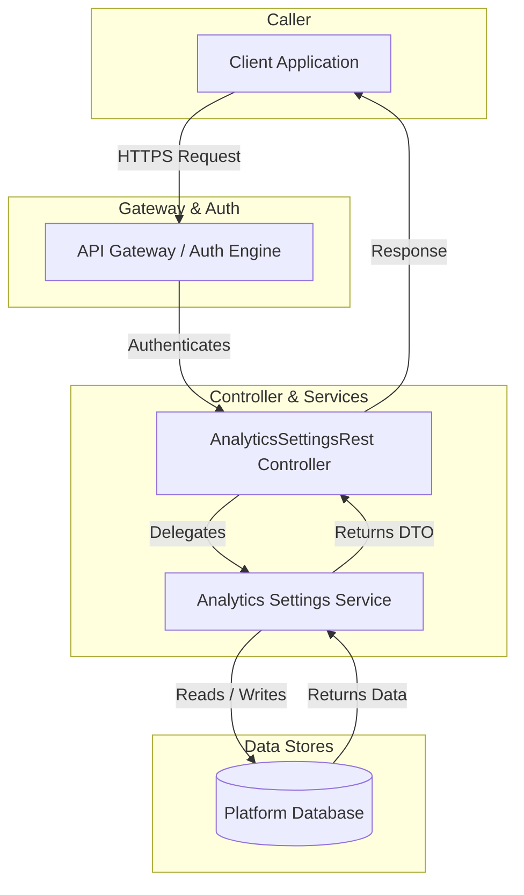

| Property | Value |
| :--- | :--- |
| Deployed as | Global REST API - OpenAPI |
| Endpoints | 15 |
| Base path | `https://platform.nlproducts.net/o` |

:::note
This documentation covers Part 1 of 2 for `AnalyticsSettingsRest`. Additional endpoints continue in Part 2.
:::

## Architecture



## Configuration

- Auth: Requires valid user authentication headers on all requests (`auth_required: true`).
- Base path: All endpoints are relative to `https://platform.nlproducts.net/o`.

## Data

- Request and response formats support `application/json` and `application/xml` media types.
- Schemas used across this module include `AnalyticsSettingsRest.v1.0.Channel`, `AnalyticsSettingsRest.v1.0.ContactConfiguration`, `AnalyticsSettingsRest.v1.0.DataSourceToken`, and paginated page wrappers.

## Endpoints

### POST `/analytics-settings-rest/v1.0/configuration/wizard-mode`

`[AnalyticsDXPEntityBatchExporter] AnalyticsSettingsRest.v1.0.postConfigurationWizardMode`

#### Parameters

*None*

#### Examples

**Request**

```json
{
  "wizardMode": true
}
```

**Response (200 OK)**

```json
{
  "status": "success"
}
```

&lt;/Tab>

---

### GET `/analytics-settings-rest/v1.0/channels`

`[Channel] AnalyticsSettingsRest.v1.0.getChannelsPage`

#### Parameters

| Name | Location | Type | Required | Description |
| :--- | :--- | :--- | :--- | :--- |
| `keywords` | query | string | No | Search keywords |
| `page` | query | string | No | Page number |
| `pageSize` | query | string | No | Number of items per page |
| `sort` | query | string | No | Sorting criteria |

#### Examples

**Response (200 OK)**

```json
{
  "items": [],
  "page": 1,
  "pageSize": 20,
  "totalCount": 0
}
```

---

### PATCH `/analytics-settings-rest/v1.0/channels`

`[Channel] AnalyticsSettingsRest.v1.0.patchChannel`

#### Parameters

*None*

#### Examples

**Request**

```json
{
  "name": "Updated Channel"
}
```

**Response (200 OK)**

```json
{
  "id": 1,
  "name": "Updated Channel"
}
```

---

### POST `/analytics-settings-rest/v1.0/channels`

`[Channel] AnalyticsSettingsRest.v1.0.postChannel`

#### Parameters

*None*

#### Examples

**Request**

```json
{
  "name": "New Channel"
}
```

**Response (201 Created)**

```json
{
  "id": 2,
  "name": "New Channel"
}
```

---

### GET `/analytics-settings-rest/v1.0/commerce-channels`

`[CommerceChannel] AnalyticsSettingsRest.v1.0.getCommerceChannelsPage`

#### Parameters

| Name | Location | Type | Required | Description |
| :--- | :--- | :--- | :--- | :--- |
| `keywords` | query | string | No | Search keywords |
| `page` | query | string | No | Page number |
| `pageSize` | query | string | No | Number of items per page |
| `sort` | query | string | No | Sorting criteria |

#### Examples

**Response (200 OK)**

```json
{
  "items": [],
  "page": 1,
  "pageSize": 20,
  "totalCount": 0
}
```

---

### GET `/analytics-settings-rest/v1.0/contacts/account-groups`

`[ContactAccountGroup] AnalyticsSettingsRest.v1.0.getContactAccountGroupsPage`

#### Parameters

| Name | Location | Type | Required | Description |
| :--- | :--- | :--- | :--- | :--- |
| `keywords` | query | string | No | Search keywords |
| `page` | query | string | No | Page number |
| `pageSize` | query | string | No | Number of items per page |
| `sort` | query | string | No | Sorting criteria |

#### Examples

**Response (200 OK)**

```json
{
  "items": [],
  "page": 1,
  "pageSize": 20,
  "totalCount": 0
}
```

---

### GET `/analytics-settings-rest/v1.0/contacts/configuration`

`[ContactConfiguration] AnalyticsSettingsRest.v1.0.getContactConfiguration`

#### Parameters

*None*

#### Examples

**Response (200 OK)**

```json
{
  "enabled": true
}
```

---

### PUT `/analytics-settings-rest/v1.0/contacts/configuration`

`[ContactConfiguration] AnalyticsSettingsRest.v1.0.putContactConfiguration`

#### Parameters

*None*

#### Examples

**Request**

```json
{
  "enabled": false
}
```

**Response (200 OK)**

```json
{
  "status": "updated"
}
```

---

### GET `/analytics-settings-rest/v1.0/contacts/organizations`

`[ContactOrganization] AnalyticsSettingsRest.v1.0.getContactOrganizationsPage`

#### Parameters

| Name | Location | Type | Required | Description |
| :--- | :--- | :--- | :--- | :--- |
| `keywords` | query | string | No | Search keywords |
| `page` | query | string | No | Page number |
| `pageSize` | query | string | No | Number of items per page |
| `sort` | query | string | No | Sorting criteria |

#### Examples

**Response (200 OK)**

```json
{
  "items": [],
  "page": 1,
  "pageSize": 20,
  "totalCount": 0
}
```

---

### GET `/analytics-settings-rest/v1.0/contacts/user-groups`

`[ContactUserGroup] AnalyticsSettingsRest.v1.0.getContactUserGroupsPage`

#### Parameters

| Name | Location | Type | Required | Description |
| :--- | :--- | :--- | :--- | :--- |
| `keywords` | query | string | No | Search keywords |
| `page` | query | string | No | Page number |
| `pageSize` | query | string | No | Number of items per page |
| `sort` | query | string | No | Sorting criteria |

#### Examples

**Response (200 OK)**

```json
{
  "items": [],
  "page": 1,
  "pageSize": 20,
  "totalCount": 0
}
```

---

### DELETE `/analytics-settings-rest/v1.0/data-sources`

`[DataSource] AnalyticsSettingsRest.v1.0.deleteDataSource`

#### Parameters

*None*

#### Examples

**Response (200 OK)**

```json
{
  "status": "deleted"
}
```

---

### POST `/analytics-settings-rest/v1.0/data-sources`

`[DataSource] AnalyticsSettingsRest.v1.0.postDataSource`

#### Parameters

*None*

#### Examples

**Request**

```json
{
  "token": "sample-data-source-token"
}
```

**Response (200 OK)**

```json
{
  "status": "connected"
}
```

---

### GET `/analytics-settings-rest/v1.0/fields/accounts`

`[Field] AnalyticsSettingsRest.v1.0.getFieldsAccountsPage`

#### Parameters

| Name | Location | Type | Required | Description |
| :--- | :--- | :--- | :--- | :--- |
| `keyword` | query | string | No | Search keyword |
| `page` | query | string | No | Page number |
| `pageSize` | query | string | No | Number of items per page |
| `sort` | query | string | No | Sorting criteria |

#### Examples

**Response (200 OK)**

```json
{
  "items": [],
  "page": 1,
  "pageSize": 20,
  "totalCount": 0
}
```

---

### PATCH `/analytics-settings-rest/v1.0/fields/accounts`

`[Field] AnalyticsSettingsRest.v1.0.patchFieldAccount`

#### Parameters

*None*

#### Examples

**Request**

```json
[
  {
    "fieldName": "accountField1",
    "visible": true
  }
]
```

**Response (200 OK)**

```json
{
  "status": "updated"
}
```

---

### GET `/analytics-settings-rest/v1.0/fields/orders`

`[Field] AnalyticsSettingsRest.v1.0.getFieldsOrdersPage`

#### Parameters

| Name | Location | Type | Required | Description |
| :--- | :--- | :--- | :--- | :--- |
| `keyword` | query | string | No | Search keyword |
| `page` | query | string | No | Page number |
| `pageSize` | query | string | No | Number of items per page |
| `sort` | query | string | No | Sorting criteria |

#### Examples

**Response (200 OK)**

```json
{
  "items": [],
  "page": 1,
  "pageSize": 20,
  "totalCount": 0
}
```
