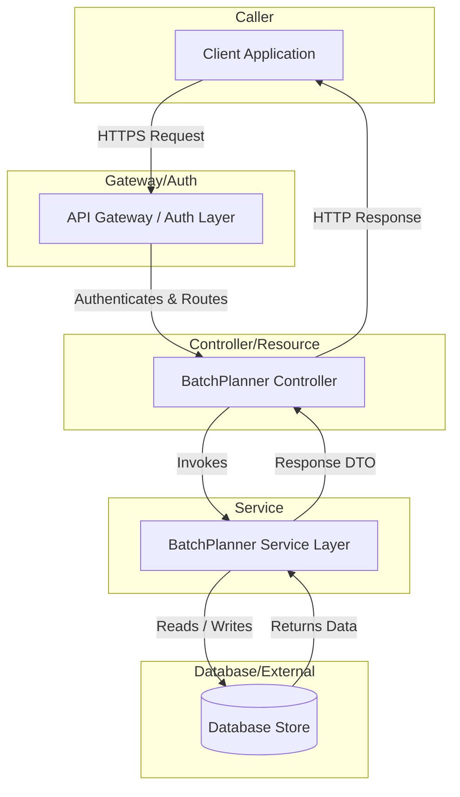

| Property | Value |
| :--- | :--- |
| Deployed as | Global REST API - OpenAPI |
| Endpoints | 9 |
| Base path | `https://platform.nlproducts.net/o` |

## Architecture



## Configuration

- Authentication: Required (`auth_required: true` for all endpoints)
- Base Path: `https://platform.nlproducts.net/o`

## Data

- `BatchPlanner.v1.0.PageField`: Schema representing paginated field definitions.
- `BatchPlanner.v1.0.PagePlan`: Schema representing paginated plan collections.
- `BatchPlanner.v1.0.Plan`: Schema representing an individual batch plan object.
- `BatchPlanner.v1.0.PageSiteScope`: Schema representing site scope definitions.
- `BatchPlanner.v1.0.PageStrategy`: Schema representing strategy definitions.

## Endpoints

### GET `/batch-planner/v1.0/plans/{internalClassNameKey}/fields`

Retrieves a paginated list of fields for a specified internal class name key.

| Parameter | Location | Type | Required | Description |
| :--- | :--- | :--- | :--- | :--- |
| `internalClassNameKey` | path | string | Yes | Internal class name key |
| `export` | query | string | No | Export format option |

```json
{
  "items": [
    {
      "name": "fieldName",
      "type": "string"
    }
  ],
  "page": 1,
  "pageSize": 20,
  "totalCount": 1
}
```

---

### GET /batch-planner/v1.0/plans

Retrieves a paginated list of batch plans.

| Parameter | Location | Type | Required | Description |
| :--- | :--- | :--- | :--- | :--- |
| `page` | query | string | No | Page number |
| `pageSize` | query | string | No | Number of items per page |

```json
{
  "items": [
    {
      "id": "plan-123",
      "name": "Sample Plan"
    }
  ],
  "page": 1,
  "pageSize": 20,
  "totalCount": 1
}
```

---

### POST /batch-planner/v1.0/plans

Creates a new batch plan.

```json
{
  "name": "New Batch Plan",
  "internalClassNameKey": "com.example.Sample"
}
```

```json
{
  "id": "plan-456",
  "name": "New Batch Plan",
  "internalClassNameKey": "com.example.Sample"
}
```

---

### GET `/batch-planner/v1.0/plans/{internalClassNameKey}/template`

Retrieves a template associated with the specified internal class name key.

| Parameter | Location | Type | Required | Description |
| :--- | :--- | :--- | :--- | :--- |
| `internalClassNameKey` | path | string | Yes | Internal class name key |

```json
{
  "binaryStream": "application/octet-stream"
}
```

---

### DELETE `/batch-planner/v1.0/plans/{planId}`

Deletes an existing batch plan by its unique identifier.

| Parameter | Location | Type | Required | Description |
| :--- | :--- | :--- | :--- | :--- |
| `planId` | path | string | Yes | Plan identifier |

```json
{
  "success": true
}
```

---

### GET `/batch-planner/v1.0/plans/{planId}`

Retrieves details for a specific batch plan.

| Parameter | Location | Type | Required | Description |
| :--- | :--- | :--- | :--- | :--- |
| `planId` | path | string | Yes | Plan identifier |

```json
{
  "id": "plan-123",
  "name": "Sample Plan",
  "internalClassNameKey": "com.example.Sample"
}
```

---

### PATCH `/batch-planner/v1.0/plans/{planId}`

Updates an existing batch plan partially.

| Parameter | Location | Type | Required | Description |
| :--- | :--- | :--- | :--- | :--- |
| `planId` | path | string | Yes | Plan identifier |

```json
{
  "name": "Updated Plan Name"
}
```

```json
{
  "id": "plan-123",
  "name": "Updated Plan Name",
  "internalClassNameKey": "com.example.Sample"
}
```

---

### GET `/batch-planner/v1.0/plans/{internalClassNameKey}/site-scopes`

Retrieves a paginated list of site scopes for a specified internal class name key.

| Parameter | Location | Type | Required | Description |
| :--- | :--- | :--- | :--- | :--- |
| `internalClassNameKey` | path | string | Yes | Internal class name key |
| `export` | query | string | No | Export format option |

```json
{
  "items": [
    {
      "siteId": "site-01",
      "scope": "GLOBAL"
    }
  ],
  "page": 1,
  "pageSize": 20,
  "totalCount": 1
}
```

---

### GET `/batch-planner/v1.0/plans/{internalClassNameKey}/strategies`

Retrieves a paginated list of strategies for a specified internal class name key.

| Parameter | Location | Type | Required | Description |
| :--- | :--- | :--- | :--- | :--- |
| `internalClassNameKey` | path | string | Yes | Internal class name key |

```json
{
  "items": [
    {
      "strategyId": "strat-01",
      "name": "Default Strategy"
    }
  ],
  "page": 1,
  "pageSize": 20,
  "totalCount": 1
}
```
