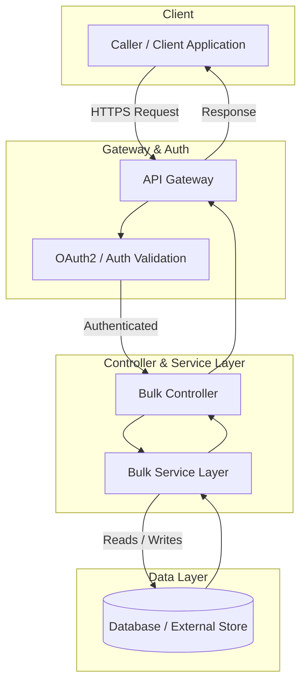

| Property | Value |
| :--- | :--- |
| Deployed as | Global REST API - OpenAPI |
| Endpoints | 8 |
| Base path | `https://platform.nlproducts.net/o` |

## Architecture



## Configuration

- Auth Required: Yes (`true` for all endpoints)
- Supported Media Types: `application/json`, `application/xml`

## Data

- Request Schemas:
  - `Bulk.v1.0.KeywordBulkSelection`
  - `Bulk.v1.0.DocumentBulkSelection`
  - `Bulk.v1.0.TaxonomyCategoryBulkSelection`
- Response Schemas:
  - `Bulk.v1.0.PageKeyword`
  - `Bulk.v1.0.Selection`
  - `Bulk.v1.0.Status`
  - `Bulk.v1.0.PageTaxonomyVocabulary`

## Endpoints

### PATCH `/bulk/v1.0/keywords/batch`

`[Keyword] Bulk.v1.0.patchKeywordBatch`

#### Parameters

*None*

#### Request Body

```json
{
  "$schema": "Bulk.v1.0.KeywordBulkSelection"
}
```

#### Response

**JSON**

```json
{
  "status": "success"
}
```

**XML**

```xml
<response>
  <status>success</status>
</response>
```

---

### PUT `/bulk/v1.0/keywords/batch`

`[Keyword] Bulk.v1.0.putKeywordBatch`

#### Parameters

*None*

#### Request Body

```json
{
  "$schema": "Bulk.v1.0.KeywordBulkSelection"
}
```

#### Response

**JSON**

```json
{
  "status": "success"
}
```

**XML**

```xml
<response>
  <status>success</status>
</response>
```

---

### POST `/bulk/v1.0/keywords/common`

`[Keyword] Bulk.v1.0.postKeywordsCommonPage`

#### Parameters

*None*

#### Request Body

```json
{
  "$schema": "Bulk.v1.0.DocumentBulkSelection"
}
```

#### Response

```json
{
  "$schema": "Bulk.v1.0.PageKeyword"
}
```

---

### POST `/bulk/v1.0/bulk-selection`

`[Selection] Bulk.v1.0.postBulkSelection`

#### Parameters

*None*

#### Request Body

```json
{
  "$schema": "Bulk.v1.0.DocumentBulkSelection"
}
```

#### Response

```json
{
  "$schema": "Bulk.v1.0.Selection"
}
```

---

### GET `/bulk/v1.0/status`

`[Status] Bulk.v1.0.getStatus`

#### Parameters

*None*

#### Response

```json
{
  "$schema": "Bulk.v1.0.Status"
}
```

---

### PATCH `/bulk/v1.0/taxonomy-categories/batch`

`[TaxonomyCategory] Bulk.v1.0.patchTaxonomyCategoryBatch`

#### Parameters

*None*

#### Request Body

```json
{
  "$schema": "Bulk.v1.0.TaxonomyCategoryBulkSelection"
}
```

#### Response

**JSON**

```json
{
  "status": "success"
}
```

**XML**

```xml
<response>
  <status>success</status>
</response>
```

---

### PUT `/bulk/v1.0/taxonomy-categories/batch`

`[TaxonomyCategory] Bulk.v1.0.putTaxonomyCategoryBatch`

#### Parameters

*None*

#### Request Body

```json
{
  "$schema": "Bulk.v1.0.TaxonomyCategoryBulkSelection"
}
```

#### Response

**JSON**

```json
{
  "status": "success"
}
```

**XML**

```xml
<response>
  <status>success</status>
</response>
```

---

### POST `/bulk/v1.0/sites/{siteId}/taxonomy-vocabularies/common`

`[TaxonomyVocabulary] Bulk.v1.0.postSiteTaxonomyVocabulariesCommonPage`

#### Parameters

| Name | Location | Type | Required | Description |
| :--- | :--- | :--- | :--- | :--- |
| `siteId` | path | string | Yes | Unique identifier of the site |

#### Request Body

```json
{
  "$schema": "Bulk.v1.0.DocumentBulkSelection"
}
```

#### Response

```json
{
  "$schema": "Bulk.v1.0.PageTaxonomyVocabulary"
}
```
