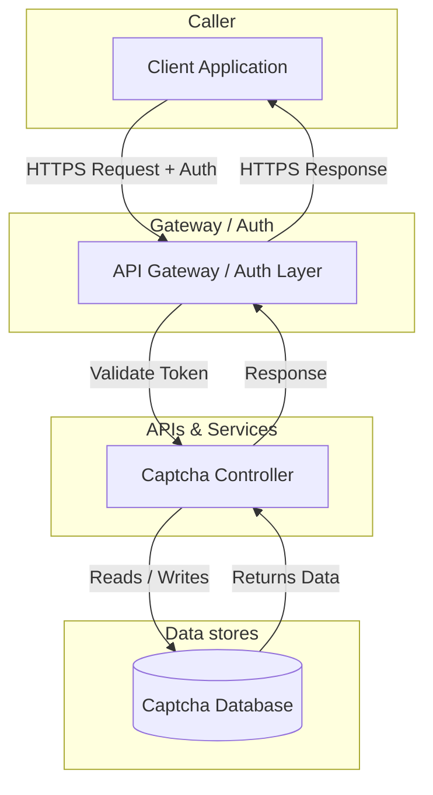

| Property | Value |
| :--- | :--- |
| Endpoints | 2 |
| Base path | `https://platform.nlproducts.net/o` |

## Architecture



## Configuration & Data

- Authentication (`auth_required`): Required (`true`) for all endpoints.
- Schemas: `Captcha.v1.0.Captcha`

## Endpoints

### GET /captcha/v1.0/captcha/challenge

`[Captcha] Captcha.v1.0.getCaptchaChallenge`

Retrieves a new captcha challenge.

**Parameters**

| Name | Type | In | Required | Description |
| :--- | :--- | :--- | :--- | :--- |
| Authorization | string | header | true | Bearer token for authentication |

**Response Example**

```json
{
  "challengeId": "string",
  "image": "string"
}
```

---

### POST /captcha/v1.0/captcha/response

`[Captcha] Captcha.v1.0.postCaptchaResponse`

Submits a response to a captcha challenge.

**Parameters**

| Name | Type | In | Required | Description |
| :--- | :--- | :--- | :--- | :--- |
| Authorization | string | header | true | Bearer token for authentication |

**Request Body Example**

```json
{
  "challengeId": "string",
  "solution": "string"
}
```

**Response Example**

```json
{
  "success": true,
  "message": "Captcha validated successfully"
}
```
