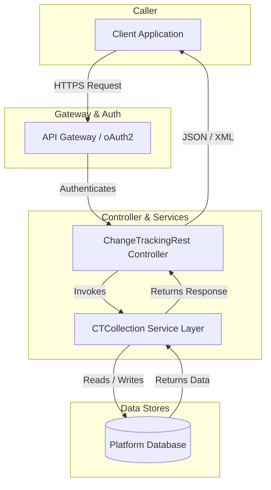

| Property | Value |
| :--- | :--- |
| Deployed as | Platform Portal / OSGi Modules |
| Endpoints | 15 |
| Base path | `https://platform.nlproducts.net/o` |

:::note
This reference document covers Part 1 of 3 for the `ChangeTrackingRest` API suite. Additional endpoint groups continue in Part 2.
:::

## Architecture



## Configuration

- Headers: `Authorization: Bearer <token>`, `Content-Type: application/json`
- Secrets: Valid OAuth2 client credentials or user session token required for all endpoints.

## Data

- Schemas: `ChangeTrackingRest.v1.0.CTCollection`, `ChangeTrackingRest.v1.0.PageCTCollection`

## Endpoints

### GET /change-tracking-rest/v1.0/ct-collections

Retrieves a paginated list of change tracking collections.

| Parameter | Location | Type | Required | Description |
| :--- | :--- | :--- | :--- | :--- |
| `page` | query | string | No | Page number to fetch |
| `pageSize` | query | string | No | Number of items per page |
| `search` | query | string | No | Search query term |
| `sort` | query | string | No | Sorting criteria |
| `status` | query | string | No | Filter by collection status |

```json
{
  "page": 1,
  "pageSize": 20,
  "items": [
    {
      "id": 123,
      "externalReferenceCode": "ERC-001",
      "name": "Staging Collection 1",
      "status": "pending"
    }
  ]
}
```

---

### POST /change-tracking-rest/v1.0/ct-collections

Creates a new change tracking collection.

```json
{
  "name": "Staging Collection 1",
  "externalReferenceCode": "ERC-001"
}
```

```json
{
  "id": 123,
  "externalReferenceCode": "ERC-001",
  "name": "Staging Collection 1",
  "status": "pending"
}
```

---

### POST /change-tracking-rest/v1.0/ct-collections/batch

Creates change tracking collections in batch mode.

| Parameter | Location | Type | Required | Description |
| :--- | :--- | :--- | :--- | :--- |
| `callbackURL` | query | string | No | Webhook URL for asynchronous notification |

```json
[
  {
    "name": "Batch Collection 1",
    "externalReferenceCode": "ERC-BATCH-1"
  }
]
```

```json
{
  "status": "accepted",
  "message": "Batch processing initiated"
}
```

---

### DELETE `/change-tracking-rest/v1.0/ct-collections/by-external-reference-code/{externalReferenceCode}`

Deletes a change tracking collection by its external reference code.

| Parameter | Location | Type | Required | Description |
| :--- | :--- | :--- | :--- | :--- |
| `externalReferenceCode` | path | string | Yes | External reference code |

```json
{
  "success": true
}
```

---

### GET `/change-tracking-rest/v1.0/ct-collections/by-external-reference-code/{externalReferenceCode}`

Retrieves a change tracking collection by its external reference code.

| Parameter | Location | Type | Required | Description |
| :--- | :--- | :--- | :--- | :--- |
| `externalReferenceCode` | path | string | Yes | External reference code |

```json
{
  "id": 123,
  "externalReferenceCode": "ERC-001",
  "name": "Staging Collection 1",
  "status": "pending"
}
```

---

### PATCH `/change-tracking-rest/v1.0/ct-collections/by-external-reference-code/{externalReferenceCode}`

Updates a change tracking collection partially by its external reference code.

| Parameter | Location | Type | Required | Description |
| :--- | :--- | :--- | :--- | :--- |
| `externalReferenceCode` | path | string | Yes | External reference code |

```json
{
  "name": "Updated Collection Name"
}
```

```json
{
  "id": 123,
  "externalReferenceCode": "ERC-001",
  "name": "Updated Collection Name",
  "status": "pending"
}
```

---

### POST `/change-tracking-rest/v1.0/ct-collections/by-external-reference-code/{externalReferenceCode}/publish`

Publishes a change tracking collection identified by its external reference code.

| Parameter | Location | Type | Required | Description |
| :--- | :--- | :--- | :--- | :--- |
| `externalReferenceCode` | path | string | Yes | External reference code |

```json
{
  "status": "published"
}
```

---

### POST `/change-tracking-rest/v1.0/ct-collections/by-external-reference-code/{externalReferenceCode}/schedule-publish`

Schedules the publication of a change tracking collection by its external reference code.

| Parameter | Location | Type | Required | Description |
| :--- | :--- | :--- | :--- | :--- |
| `externalReferenceCode` | path | string | Yes | External reference code |
| `publishDate` | query | string | No | Target publication timestamp |

```json
{
  "status": "scheduled",
  "publishDate": "2023-12-31T23:59:59Z"
}
```

---

### GET `/change-tracking-rest/v1.0/ct-collections/by-external-reference-code/{externalReferenceCode}/share-link`

Generates a share link for a collection using its external reference code.

| Parameter | Location | Type | Required | Description |
| :--- | :--- | :--- | :--- | :--- |
| `externalReferenceCode` | path | string | Yes | External reference code |

```json
"https://platform.nlproducts.net/web/guest/share/ERC-001"
```

---

### GET `/change-tracking-rest/v1.0/ct-collections/b{ctCollectionId}/share-link`

Generates a share link for a collection by its identifier.

| Parameter | Location | Type | Required | Description |
| :--- | :--- | :--- | :--- | :--- |
| `ctCollectionId` | path | string | Yes | Change tracking collection ID |

```json
"https://platform.nlproducts.net/web/guest/share/123"
```

---

### POST /change-tracking-rest/v1.0/ct-collections/export-batch

Initiates a batch export of change tracking collections.

| Parameter | Location | Type | Required | Description |
| :--- | :--- | :--- | :--- | :--- |
| `search` | query | string | No | Search query filter |
| `sort` | query | string | No | Sorting criteria |
| `status` | query | string | No | Status filter |
| `callbackURL` | query | string | No | Webhook callback URL |
| `contentType` | query | string | No | Export content type |
| `fieldNames` | query | string | No | Comma-separated field names |

```json
{
  "status": "accepted",
  "jobId": "exp-9988"
}
```

---

### DELETE `/change-tracking-rest/v1.0/ct-collections/{ctCollectionId}`

Deletes a change tracking collection by ID.

| Parameter | Location | Type | Required | Description |
| :--- | :--- | :--- | :--- | :--- |
| `ctCollectionId` | path | string | Yes | Change tracking collection ID |

```json
{
  "success": true
}
```

---

### GET `/change-tracking-rest/v1.0/ct-collections/{ctCollectionId}`

Retrieves a change tracking collection by ID.

| Parameter | Location | Type | Required | Description |
| :--- | :--- | :--- | :--- | :--- |
| `ctCollectionId` | path | string | Yes | Change tracking collection ID |

```json
{
  "id": 123,
  "externalReferenceCode": "ERC-001",
  "name": "Staging Collection 1",
  "status": "pending"
}
```

---

### PATCH `/change-tracking-rest/v1.0/ct-collections/{ctCollectionId}`

Partially updates a change tracking collection by ID.

| Parameter | Location | Type | Required | Description |
| :--- | :--- | :--- | :--- | :--- |
| `ctCollectionId` | path | string | Yes | Change tracking collection ID |

```json
{
  "name": "Updated Staging Collection"
}
```

```json
{
  "id": 123,
  "externalReferenceCode": "ERC-001",
  "name": "Updated Staging Collection",
  "status": "pending"
}
```

---

### PUT `/change-tracking-rest/v1.0/ct-collections/{ctCollectionId}`

Replaces a change tracking collection entirely by ID.

| Parameter | Location | Type | Required | Description |
| :--- | :--- | :--- | :--- | :--- |
| `ctCollectionId` | path | string | Yes | Change tracking collection ID |

```json
{
  "id": 123,
  "externalReferenceCode": "ERC-001",
  "name": "Replaced Collection",
  "status": "pending"
}
```

```json
{
  "id": 123,
  "externalReferenceCode": "ERC-001",
  "name": "Replaced Collection",
  "status": "pending"
}
```
