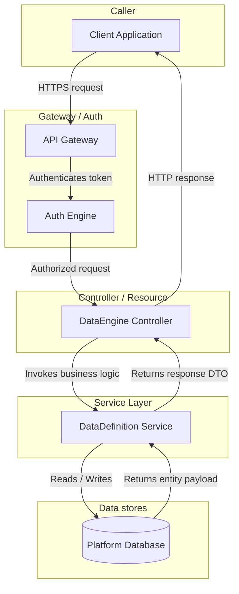

| Property | Value |
| :--- | :--- |
| Deployed as | Global REST API - OpenAPI |
| Endpoints | 15 |
| Base path | `https://platform.nlproducts.net/o` |

:::note
This is Part 1 of 5 for the DataEngine API reference. Additional endpoints and items continue in Part 2.
:::

## Architecture



## Configuration

- Base authentication requires a verified OAuth2 bearer token or API key passed in the authorization header.
- Content types must be explicitly declared for requests utilizing JSON payloads.

## Data

- Uses `DataEngine.v2.0.DataDefinition` schemas for managing field structures and metadata.
- Paginated responses rely on `DataEngine.v2.0.PageDataDefinition` and `DataEngine.v2.0.PagePermission`.

## Endpoints

### DELETE `/data-engine/v2.0/data-definitions/batch`

`[DataDefinition] DataEngine.v2.0.deleteDataDefinitionBatch`

#### Parameters

| Name | Location | Type | Required | Description |
| :--- | :--- | :--- | :--- | :--- |
| `callbackURL` | query | string | No | Optional callback URL for asynchronous batch processing. |

#### Example

**Request**

```json
{
  "ids": ["def-123", "def-456"]
}
```

**Response**

```json
{
  "status": "ACCEPTED"
}
```

---

### PUT `/data-engine/v2.0/data-definitions/batch`

`[DataDefinition] DataEngine.v2.0.putDataDefinitionBatch`

#### Parameters

| Name | Location | Type | Required | Description |
| :--- | :--- | :--- | :--- | :--- |
| `callbackURL` | query | string | No | Optional callback URL for asynchronous batch processing. |

#### Example

**Request**

```json
{
  "items": []
}
```

**Response**

```json
{
  "status": "UPDATED"
}
```

---

### GET `/data-engine/v2.0/data-definitions/by-content-type/{contentType}`

`[DataDefinition] DataEngine.v2.0.getDataDefinitionByContentTypeContentTypePage`

#### Parameters

| Name | Location | Type | Required | Description |
| :--- | :--- | :--- | :--- | :--- |
| `contentType` | path | string | Yes | Target content type identifier. |
| `keywords` | query | string | No | Search keywords. |
| `page` | query | string | No | Page number. |
| `pageSize` | query | string | No | Number of items per page. |
| `sort` | query | string | No | Sorting criteria. |

#### Example

**Response**

```json
{
  "items": [],
  "page": 1,
  "pageSize": 20,
  "totalCount": 0
}
```

---

### POST `/data-engine/v2.0/data-definitions/by-content-type/{contentType}`

`[DataDefinition] DataEngine.v2.0.postDataDefinitionByContentType`

#### Parameters

| Name | Location | Type | Required | Description |
| :--- | :--- | :--- | :--- | :--- |
| `contentType` | path | string | Yes | Target content type identifier. |

#### Example

**Request**

```json
{
  "name": "Employee Record",
  "dataDefinitionFields": []
}
```

**Response**

```json
{
  "id": "def-789",
  "name": "Employee Record"
}
```

---

### GET `/data-engine/v2.0/data-definitions/data-definition-fields/field-types`

`[DataDefinition] DataEngine.v2.0.getDataDefinitionDataDefinitionFieldFieldTypes`

#### Example

**Response**

```json
"[\"text\", \"numeric\", \"select\"]"
```

---

### DELETE `/data-engine/v2.0/data-definitions/{dataDefinitionId}`

`[DataDefinition] DataEngine.v2.0.deleteDataDefinition`

#### Parameters

| Name | Location | Type | Required | Description |
| :--- | :--- | :--- | :--- | :--- |
| `dataDefinitionId` | path | string | Yes | Unique data definition identifier. |

#### Example

**Response**

```json
{
  "success": true
}
```

---

### GET `/data-engine/v2.0/data-definitions/{dataDefinitionId}`

`[DataDefinition] DataEngine.v2.0.getDataDefinition`

#### Parameters

| Name | Location | Type | Required | Description |
| :--- | :--- | :--- | :--- | :--- |
| `dataDefinitionId` | path | string | Yes | Unique data definition identifier. |

#### Example

**Response**

```json
{
  "id": "def-123",
  "name": "Sample Definition"
}
```

---

### PATCH `/data-engine/v2.0/data-definitions/{dataDefinitionId}`

`[DataDefinition] DataEngine.v2.0.patchDataDefinition`

#### Parameters

| Name | Location | Type | Required | Description |
| :--- | :--- | :--- | :--- | :--- |
| `dataDefinitionId` | path | string | Yes | Unique data definition identifier. |

#### Example

**Request**

```json
{
  "name": "Updated Sample Name"
}
```

**Response**

```json
{
  "id": "def-123",
  "name": "Updated Sample Name"
}
```

---

### PUT `/data-engine/v2.0/data-definitions/{dataDefinitionId}`

`[DataDefinition] DataEngine.v2.0.putDataDefinition`

#### Parameters

| Name | Location | Type | Required | Description |
| :--- | :--- | :--- | :--- | :--- |
| `dataDefinitionId` | path | string | Yes | Unique data definition identifier. |

#### Example

**Request**

```json
{
  "name": "Replaced Definition"
}
```

**Response**

```json
{
  "id": "def-123",
  "name": "Replaced Definition"
}
```

---

### POST `/data-engine/v2.0/data-definitions/{dataDefinitionId}/copy`

`[DataDefinition] DataEngine.v2.0.postDataDefinitionCopy`

#### Parameters

| Name | Location | Type | Required | Description |
| :--- | :--- | :--- | :--- | :--- |
| `dataDefinitionId` | path | string | Yes | Unique data definition identifier to copy. |

#### Example

**Response**

```json
{
  "id": "def-copy-999",
  "name": "Sample Definition (Copy)"
}
```

---

### GET `/data-engine/v2.0/data-definitions/{dataDefinitionId}/permissions`

`[DataDefinition] DataEngine.v2.0.getDataDefinitionPermissionsPage`

#### Parameters

| Name | Location | Type | Required | Description |
| :--- | :--- | :--- | :--- | :--- |
| `dataDefinitionId` | path | string | Yes | Unique data definition identifier. |
| `roleNames` | query | string | No | Filter by role names. |

#### Example

**Response**

```json
{
  "items": []
}
```

---

### PUT `/data-engine/v2.0/data-definitions/{dataDefinitionId}/permissions`

`[DataDefinition] DataEngine.v2.0.putDataDefinitionPermissionsPage`

#### Parameters

| Name | Location | Type | Required | Description |
| :--- | :--- | :--- | :--- | :--- |
| `dataDefinitionId` | path | string | Yes | Unique data definition identifier. |

#### Example

**Request**

```json
[
  {
    "roleName": "Administrator",
    "permissions": ["VIEW", "UPDATE"]
  }
]
```

**Response**

```json
{
  "items": []
}
```

---

### GET `/data-engine/v2.0/sites/{siteId}/data-definitions/by-content-type/{contentType}`

`[DataDefinition] DataEngine.v2.0.getSiteDataDefinitionByContentTypeContentTypePage`

#### Parameters

| Name | Location | Type | Required | Description |
| :--- | :--- | :--- | :--- | :--- |
| `siteId` | path | string | Yes | Site identifier. |
| `contentType` | path | string | Yes | Target content type identifier. |
| `keywords` | query | string | No | Search keywords. |
| `page` | query | string | No | Page number. |
| `pageSize` | query | string | No | Page size. |
| `sort` | query | string | No | Sort field. |

#### Example

**Response**

```json
{
  "items": [],
  "totalCount": 0
}
```

---

### POST `/data-engine/v2.0/sites/{siteId}/data-definitions/by-content-type/{contentType}`

`[DataDefinition] DataEngine.v2.0.postSiteDataDefinitionByContentType`

#### Parameters

| Name | Location | Type | Required | Description |
| :--- | :--- | :--- | :--- | :--- |
| `siteId` | path | string | Yes | Site identifier. |
| `contentType` | path | string | Yes | Target content type identifier. |

#### Example

**Request**

```json
{
  "name": "Site Definition"
}
```

**Response**

```json
{
  "id": "site-def-1",
  "name": "Site Definition"
}
```

---

### GET `/data-engine/v2.0/sites/{siteId}/data-definitions/by-content-type/{contentType}/by-data-definition-key/{dataDefinitionKey}`

`[DataDefinition] DataEngine.v2.0.getSiteDataDefinitionByContentTypeByDataDefinitionKey`

#### Parameters

| Name | Location | Type | Required | Description |
| :--- | :--- | :--- | :--- | :--- |
| `siteId` | path | string | Yes | Site identifier. |
| `contentType` | path | string | Yes | Target content type identifier. |
| `dataDefinitionKey` | path | string | Yes | Data definition key. |

#### Example

**Response**

```json
{
  "id": "site-def-1",
  "key": "unique-key"
}
```
