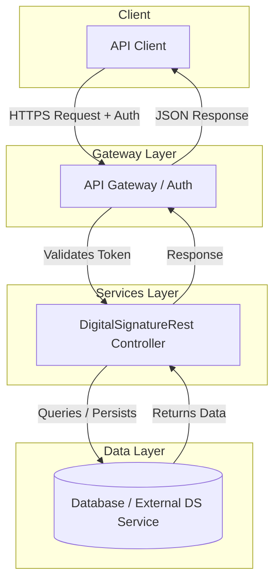

| Property | Value |
| :--- | :--- |
| Deployed as | Global REST API - OpenAPI |
| Endpoints | 6 |
| Base path | `https://platform.nlproducts.net/o` |

## Architecture



## Configuration

- Authentication: `auth_required` is enabled (`true`) for all endpoints, requiring valid platform credentials.
- Base URL: All requests must be routed against `https://platform.nlproducts.net/o`.

## Data

- Schemas:
  - `DigitalSignatureRest.v1.0.DSEnvelope`
  - `DigitalSignatureRest.v1.0.PageDSEnvelope`
  - `DigitalSignatureRest.v1.0.DSRecipientViewDefinition`
  - `DigitalSignatureRest.v1.0.DSEnvelopeSignatureURL`

## Endpoints

### GET `/digital-signature-rest/v1.0/sites/{siteId}/ds-envelopes`

Retrieves a paginated list of digital signature envelopes for a specific site.

| Parameter | Location | Type | Required | Description |
| :--- | :--- | :--- | :--- | :--- |
| `siteId` | path | string | Yes | Unique site identifier |
| `fromDate` | query | string | No | Filter envelopes created from this date |
| `keywords` | query | string | No | Search keywords |
| `order` | query | string | No | Sort order |
| `page` | query | string | No | Page number |
| `pageSize` | query | string | No | Number of items per page |
| `status` | query | string | No | Filter by envelope status |

**Request**

```http
GET /digital-signature-rest/v1.0/sites/12345/ds-envelopes?page=1&pageSize=10 HTTP/1.1
Host: platform.nlproducts.net
Authorization: Bearer <token>
```

**Response**

```json
{
  "items": [
    {
      "id": "env_01",
      "status": "completed"
    }
  ],
  "page": 1,
  "pageSize": 10,
  "totalCount": 1
}
```

---

### POST `/digital-signature-rest/v1.0/sites/{siteId}/ds-envelopes`

Creates a new digital signature envelope for a site.

| Parameter | Location | Type | Required | Description |
| :--- | :--- | :--- | :--- | :--- |
| `siteId` | path | string | Yes | Unique site identifier |

**Request**

```json
{
  "envelopeName": "Contract Agreement",
  "recipients": [
    {
      "email": "signatory@example.com",
      "name": "Jane Doe"
    }
  ]
}
```

**Response**

```json
{
  "id": "env_02",
  "status": "created"
}
```

---

### POST `/digital-signature-rest/v1.0/sites/{siteId}/ds-envelopes/batch`

Creates multiple digital signature envelopes in a batch operation.

| Parameter | Location | Type | Required | Description |
| :--- | :--- | :--- | :--- | :--- |
| `siteId` | path | string | Yes | Unique site identifier |
| `callbackURL` | query | string | No | Callback endpoint for batch completion notification |

**Request**

```json
{
  "batchEnvelopes": [
    {
      "envelopeName": "Batch Doc 1"
    }
  ]
}
```

**Response**

```json
{
  "status": "accepted",
  "batchId": "batch_99"
}
```

---

### POST `/digital-signature-rest/v1.0/sites/{siteId}/ds-envelopes/export-batch`

Exports a batch of digital signature envelopes based on filter parameters.

| Parameter | Location | Type | Required | Description |
| :--- | :--- | :--- | :--- | :--- |
| `siteId` | path | string | Yes | Unique site identifier |
| `fromDate` | query | string | No | Filter envelopes created from this date |
| `keywords` | query | string | No | Search keywords |
| `order` | query | string | No | Sort order |
| `status` | query | string | No | Filter by envelope status |
| `callbackURL` | query | string | No | Callback endpoint for export completion |
| `contentType` | query | string | No | Response content format |
| `fieldNames` | query | string | No | Specific fields to include in export |

**Request**

```http
POST /digital-signature-rest/v1.0/sites/12345/ds-envelopes/export-batch?status=completed HTTP/1.1
Host: platform.nlproducts.net
Authorization: Bearer <token>
```

**Response**

```json
{
  "exportJobId": "job_55",
  "status": "processing"
}
```

---

### GET `/digital-signature-rest/v1.0/sites/{siteId}/ds-envelopes/{dsEnvelopeId}`

Retrieves details for a specific digital signature envelope.

| Parameter | Location | Type | Required | Description |
| :--- | :--- | :--- | :--- | :--- |
| `siteId` | path | string | Yes | Unique site identifier |
| `dsEnvelopeId` | path | string | Yes | Envelope identifier |

**Request**

```http
GET /digital-signature-rest/v1.0/sites/12345/ds-envelopes/env_01 HTTP/1.1
Host: platform.nlproducts.net
Authorization: Bearer <token>
```

**Response**

```json
{
  "id": "env_01",
  "envelopeName": "Contract Agreement",
  "status": "completed"
}
```

---

### POST `/digital-signature-rest/v1.0/sites/{siteId}/ds-recipient-view-definition/{dsEnvelopeId}`

Generates a recipient view definition and signature URL for an envelope.

| Parameter | Location | Type | Required | Description |
| :--- | :--- | :--- | :--- | :--- |
| `siteId` | path | string | Yes | Unique site identifier |
| `dsEnvelopeId` | path | string | Yes | Envelope identifier |

**Request**

```json
{
  "returnUrl": "https://example.com/return",
  "userName": "Jane Doe",
  "email": "signatory@example.com"
}
```

**Response**

```json
{
  "url": "https://signing.service.com/session/token_xyz"
}
```
