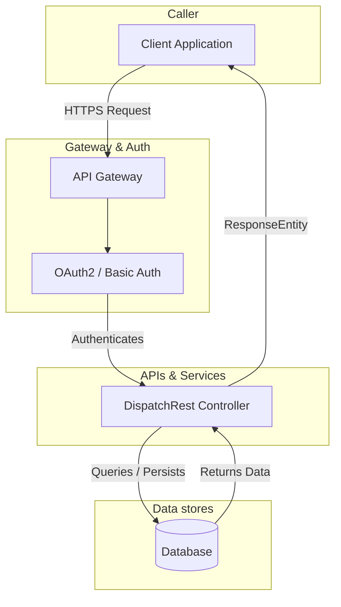

# DispatchRest

| Property | Value |
| :--- | :--- |
| Deployed as | `Global REST API - OpenAPI` |
| Endpoints | 5 |
| Base path | `https://platform.nlproducts.net/o` |

## Architecture



## Configuration

- Authentication: Requires valid credentials (`auth_required: true` for all endpoints).
- Headers: Standard `Content-Type: application/json` and `Accept: application/json`.

## Data

- Schemas: `DispatchRest.v1.0.DispatchTrigger`, `DispatchRest.v1.0.PageDispatchTrigger`

## Endpoints

### GET /dispatch-rest/v1.0/dispatch-triggers

Retrieve a page of dispatch triggers.

| Parameter | Location | Type | Required | Description |
| :--- | :--- | :--- | :--- | :--- |
- None -

```json
{
  "items": [
    {
      "id": "string",
      "name": "string"
    }
  ],
  "page": 1,
  "pageSize": 20,
  "totalCount": 1
}
```

### POST /dispatch-rest/v1.0/dispatch-triggers

Create a new dispatch trigger.

| Parameter | Location | Type | Required | Description |
| :--- | :--- | :--- | :--- | :--- |
- None -

```json
{
  "name": "string",
  "description": "string"
}
```

```json
{
  "id": "string",
  "name": "string",
  "description": "string"
}
```

### POST /dispatch-rest/v1.0/dispatch-triggers/batch

Create dispatch triggers in batch.

| Parameter | Location | Type | Required | Description |
| :--- | :--- | :--- | :--- | :--- |
| `callbackURL` | query | string | false | Optional callback URL for asynchronous processing |

```json
[
  {
    "name": "string",
    "description": "string"
  }
]
```

```json
{
  "status": "Accepted",
  "callbackURL": "string"
}
```

### POST /dispatch-rest/v1.0/dispatch-triggers/export-batch

Export dispatch triggers in batch.

| Parameter | Location | Type | Required | Description |
| :--- | :--- | :--- | :--- | :--- |
| `callbackURL` | query | string | false | Optional callback URL for asynchronous processing |
| `contentType` | query | string | false | Desired export content type |
| `fieldNames` | query | string | false | Specific field names to include in export |

```json
{
  "status": "Accepted",
  "callbackURL": "string"
}
```

### POST `/dispatch-rest/v1.0/dispatch-triggers/{dispatchTriggerId}/run`

Run a specific dispatch trigger by its identifier.

| Parameter | Location | Type | Required | Description |
| :--- | :--- | :--- | :--- | :--- |
| `dispatchTriggerId` | path | string | true | Unique identifier of the dispatch trigger |

```json
{
  "executionId": "string",
  "status": "Running"
}
```
