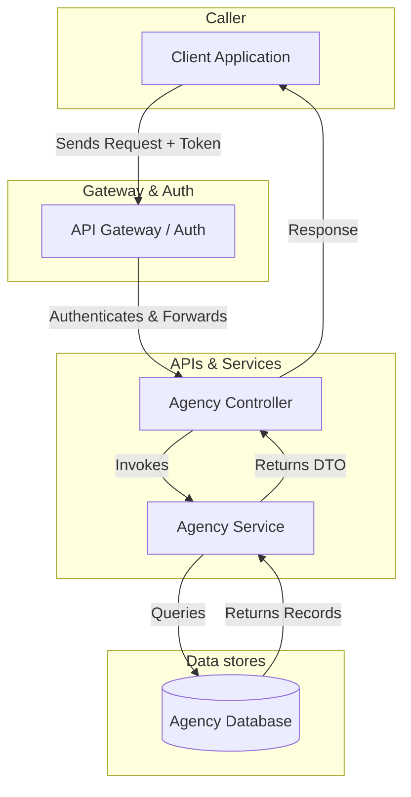

| Property | Value |
| :--- | :--- |
| Deployed as | `GovCon API` |
| Endpoints | 8 |
| Base path | `https://nl-govcon-agency-api-qa-internal.nlproducts.net` |

## Architecture



## Configuration & Data

- Authentication: All endpoints require authentication via secure authorization tokens (`auth_required: true`).
- Schemas: Uses `DataList` and `Wrapper` for response formats, and `PeopleSearchCriteria` and `AgencyInput` for request bodies.

## Endpoints

### POST /api/agency/v1/types

Fetches a list of all unique agency types available in the Agency data.

#### Parameters

| Name | Location | Type | Required | Description |
| :--- | :--- | :--- | :--- | :--- |
| `page` | query | integer(int32) | Yes | Page number |
| `limit` | query | integer(int32) | Yes | Items per page |

#### Example Request

```json
{
  "page": 0,
  "limit": 10
}
```

#### Example Response

```json
{
  "totalElements": 2,
  "totalPages": 1,
  "content": [
    "Cabinet-level",
    "Independent Agency"
  ]
}
```

---

### POST /api/agency/v1/people

Get Vendors people data.

#### Parameters

| Name | Location | Type | Required | Description |
| :--- | :--- | :--- | :--- | :--- |
| `page` | query | integer(int32) | Yes | Page number (0-based) |
| `limit` | query | integer(int32) | Yes | Items per page |

#### Example Request

```json
{
  "vendorName": "Acme Corp"
}
```

#### Example Response

```json
{
  "totalElements": 1,
  "totalPages": 1,
  "content": [
    {
      "name": "Jane Doe",
      "title": "Contract Officer",
      "email": "jane.doe@example.com"
    }
  ]
}
```

---

### POST /api/agency/v1/names

Fetches a list of all unique agency names present in the Agency data.

#### Parameters

| Name | Location | Type | Required | Description |
| :--- | :--- | :--- | :--- | :--- |
| `page` | query | integer(int32) | Yes | Page number |
| `limit` | query | integer(int32) | Yes | Items per page |

#### Example Request

```json
{
  "page": 0,
  "limit": 10
}
```

#### Example Response

```json
{
  "totalElements": 2,
  "totalPages": 1,
  "content": [
    "Department of Defense",
    "Department of Energy"
  ]
}
```

---

### POST /api/agency/v1/hierarchy

Returns agency details along with its ancestors and immediate children for the given agency code.

#### Parameters

| Name | Location | Type | Required | Description |
| :--- | :--- | :--- | :--- | :--- |
| `org_key` | query | integer(int64) | Yes | Agency org_key |

#### Example Request

```json
{
  "org_key": 10045
}
```

#### Example Response

```json
{
  "totalElements": 1,
  "totalPages": 1,
  "content": [
    {
      "orgKey": 10045,
      "name": "Department of Defense",
      "ancestors": [],
      "children": []
    }
  ]
}
```

---

### POST /api/agency/v1/agencies

Search agencies using filters like agency type and active status.

#### Parameters

| Name | Location | Type | Required | Description |
| :--- | :--- | :--- | :--- | :--- |
| `page` | query | integer(int32) | Yes | Page number |
| `limit` | query | integer(int32) | Yes | Items per page |

#### Example Request

```json
{
  "agencyType": "Cabinet-level",
  "activeStatus": true
}
```

#### Example Response

```json
{
  "totalElements": 1,
  "totalPages": 1,
  "content": [
    {
      "orgKey": 10001,
      "name": "Department of Defense"
    }
  ]
}
```

---

### GET /api/agency/v1/regional-locations

Returns regional office locations (title, region, phone, address) for the given agency org_key.

#### Parameters

| Name | Location | Type | Required | Description |
| :--- | :--- | :--- | :--- | :--- |
| `org_key` | query | integer(int64) | Yes | Agency org_key |
| `page` | query | integer(int32) | No | Page number (0-based) |
| `limit` | query | integer(int32) | No | Items per page |

#### Example Request

```bash
GET /api/agency/v1/regional-locations?org_key=10045&page=0&limit=10
```

#### Example Response

```json
{
  "totalElements": 1,
  "totalPages": 1,
  "content": [
    {
      "title": "Regional Office East",
      "region": "Region 1",
      "phone": "555-0199",
      "address": "123 Federal Way"
    }
  ]
}
```

---

### GET /api/agency/v1/detail

Fetch a single agency detail wrapped in paginated format using org_key.

#### Parameters

| Name | Location | Type | Required | Description |
| :--- | :--- | :--- | :--- | :--- |
| `org_key` | query | integer(int64) | Yes | Agency org_key |

#### Example Request

```bash
GET /api/agency/v1/detail?org_key=10045
```

#### Example Response

```json
{
  "totalElements": 1,
  "totalPages": 1,
  "content": [
    {
      "orgKey": 10045,
      "name": "Department of Defense",
      "code": "DOD"
    }
  ]
}
```

---

### GET /api/agency/v1/budgetory-resource-obligation

Returns Get Agency Budgetory Resource obligation amount.

#### Parameters

| Name | Location | Type | Required | Description |
| :--- | :--- | :--- | :--- | :--- |
| `org_key` | query | integer(int64) | Yes | Agency org_key |

#### Example Request

```bash
GET /api/agency/v1/budgetory-resource-obligation?org_key=10045
```

#### Example Response

```json
{
  "data": {
    "orgKey": 10045,
    "obligationAmount": 540000000.00
  }
}
```
