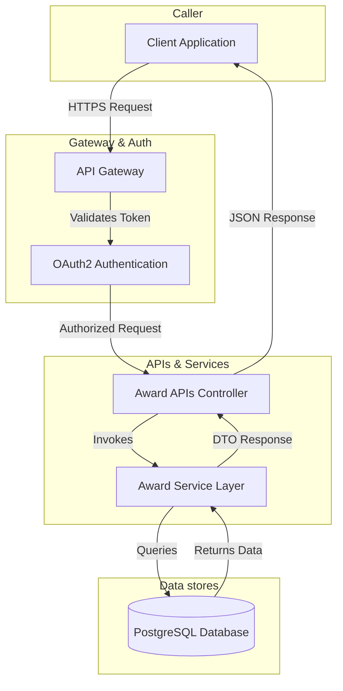

---
description: "API reference for GovCon Award APIs Part 1, covering award details, subawards, agency obligations, and summaries."
---

| Property | Value |
| :--- | :--- |
| Deployed as | GovCon API |
| Endpoints | 15 |
| Base path | `https://nl-govcon-agency-api-qa-internal.nlproducts.net` |

:::note
This document covers Part 1 of the Award APIs, containing 15 endpoints. Additional items continue in Part 2.
:::

## Architecture



## Configuration

- Base URL: `https://nl-govcon-agency-api-qa-internal.nlproducts.net`
- Authentication: Bearer token required for all endpoints (`auth_required: true`).

## Data

- Request body schemas: `SubAwardInput`, `State`, `Psc`, `Naics`, `AwardInput`, `AgencyVendor`, `AgencyCode`
- Response schemas: `DataList`, `Wrapper`

## Endpoints

### POST /api/award/v1/subawards

Search subawards (PG).

**Parameters**

| Name | Location | Type | Required | Description |
| :--- | :--- | :--- | :--- | :--- |
| `page` | query | integer(int32) | Yes | Page number |
| `limit` | query | integer(int32) | Yes | Items per page |

**Request**

```json
{
  "search_criteria": "string"
}
```

**Response**

```json
{
  "content": [],
  "pageable": {
    "pageNumber": 0,
    "pageSize": 10
  },
  "totalElements": 0
}
```

---

### POST /api/award/v1/subaward-state-summary

Get state summary for a subawardee UEI (subawards).

**Parameters**

| Name | Location | Type | Required | Description |
| :--- | :--- | :--- | :--- | :--- |
| `uei` | query | string | Yes | Subawardee UEI |
| `page` | query | integer(int32) | No | Page number |
| `limit` | query | integer(int32) | No | Items per page |

**Request**

```json
{
  "state_filter": "string"
}
```

**Response**

```json
{
  "content": []
}
```

---

### POST /api/award/v1/state-summary

Get state summary for a recipient UEI (awards).

**Parameters**

| Name | Location | Type | Required | Description |
| :--- | :--- | :--- | :--- | :--- |
| `uei` | query | string | Yes | Recipient UEI |
| `page` | query | integer(int32) | No | Page number |
| `limit` | query | integer(int32) | No | Items per page |

**Request**

```json
{
  "state_filter": "string"
}
```

**Response**

```json
{
  "content": []
}
```

---

### POST /api/award/v1/psc-summary

Get PSC summary for a recipient.

**Parameters**

| Name | Location | Type | Required | Description |
| :--- | :--- | :--- | :--- | :--- |
| `uei` | query | string | Yes | Recipient UEI |
| `page` | query | integer(int32) | No | Page number |
| `limit` | query | integer(int32) | No | Items per page |

**Request**

```json
{
  "psc_filter": "string"
}
```

**Response**

```json
{
  "content": []
}
```

---

### POST /api/award/v1/naics-summary

Get NAICS summary for a recipient.

**Parameters**

| Name | Location | Type | Required | Description |
| :--- | :--- | :--- | :--- | :--- |
| `uei` | query | string | Yes | Recipient UEI |
| `page` | query | integer(int32) | No | Page number |
| `limit` | query | integer(int32) | No | Items per page |

**Request**

```json
{
  "naics_filter": "string"
}
```

**Response**

```json
{
  "content": []
}
```

---

### POST /api/award/v1/awards

Get award details. Search awards using filters like NAICS, PSC, agency, etc.

**Parameters**

| Name | Location | Type | Required | Description |
| :--- | :--- | :--- | :--- | :--- |
| `page` | query | integer(int32) | Yes | Page number |
| `limit` | query | integer(int32) | Yes | Items per page |

**Request**

```json
{
  "naics_codes": ["541512"],
  "psc_codes": ["R425"]
}
```

**Response**

```json
{
  "content": []
}
```

---

### POST /api/award/v1/agency/vendors

Get agencies vendor by org key.

**Parameters**

| Name | Location | Type | Required | Description |
| :--- | :--- | :--- | :--- | :--- |
| `org_key` | query | integer(int32) | Yes | Agency Org Key |
| `page` | query | integer(int32) | No | Page number |
| `limit` | query | integer(int32) | No | Items per page |

**Request**

```json
{
  "filter": "string"
}
```

**Response**

```json
{
  "content": []
}
```

---

### POST /api/award/v1/agency-code-summary

Get code-wise obligation summary for an agency (PG).

**Parameters**

| Name | Location | Type | Required | Description |
| :--- | :--- | :--- | :--- | :--- |
| `awarding_org_key` | query | integer(int32) | No | Awarding Agency Org Key |
| `funding_org_key` | query | integer(int32) | No | Funding Agency Org Key |
| `code_field` | query | string | Yes | Code field (e.g., naicsCode, productOrServiceCode, popStateCode) |
| `description_field` | query | string | No | Description field (e.g., naicsDescription, productOrServiceDescription) |
| `level` | query | integer(int32) | No | Level |
| `page` | query | integer(int32) | No | Page number |
| `limit` | query | integer(int32) | No | Items per page |

**Request**

```json
{
  "agency_filter": "string"
}
```

**Response**

```json
{
  "content": []
}
```

---

### GET /api/award/v1/yearly-obligation-by-parent

Get year-wise total obligation for a parent award PIID i.e. contract_number.

**Parameters**

| Name | Location | Type | Required | Description |
| :--- | :--- | :--- | :--- | :--- |
| `parent_award_pi_id` | query | string | Yes | Parent Award PIID |
| `page` | query | integer(int32) | No | Page number |
| `limit` | query | integer(int32) | No | Items per page |

**Response**

```json
{
  "content": []
}
```

---

### GET /api/award/v1/top/awards

Get top awards.

**Parameters**

| Name | Location | Type | Required | Description |
| :--- | :--- | :--- | :--- | :--- |
| `uei` | query | string | Yes | recipient uei |

**Response**

```json
{
  "data": {}
}
```

---

### GET /api/award/v1/subawards/total-amount

Get total subaward amount for a parent award PIID (PG).

**Parameters**

| Name | Location | Type | Required | Description |
| :--- | :--- | :--- | :--- | :--- |
| `parent_award_pi_id` | query | string | Yes | Parent Award PIID |
| `page` | query | integer(int32) | No | Page number |
| `limit` | query | integer(int32) | No | Items per page |

**Response**

```json
{
  "content": []
}
```

---

### GET /api/award/v1/recipient-unique-awards-summary

Get unique award count and total obligation for a recipient. Returns the total number of unique award IDs and the sum of total obligations for the given recipient UEI.

**Parameters**

| Name | Location | Type | Required | Description |
| :--- | :--- | :--- | :--- | :--- |
| `uei` | query | string | Yes | Recipient UEI |

**Response**

```json
{
  "content": []
}
```

---

### GET /api/award/v1/recipient-summary

Get total award obligation and count for a recipient UEI.

**Parameters**

| Name | Location | Type | Required | Description |
| :--- | :--- | :--- | :--- | :--- |
| `uei` | query | string | Yes | Recipient UEI |
| `page` | query | integer(int32) | No | Page number |
| `limit` | query | integer(int32) | No | Items per page |

**Response**

```json
{
  "content": []
}
```

---

### GET /api/award/v1/pop-timeline

Get Period of Performance Timeline.

**Parameters**

| Name | Location | Type | Required | Description |
| :--- | :--- | :--- | :--- | :--- |
| `contract_number` | query | string | Yes | Contract number |
| `award_type` | query | string | Yes | Award type |

**Response**

```json
{
  "data": {}
}
```

---

### GET /api/award/v1/location-summary

Get location summary for a recipient.

**Parameters**

| Name | Location | Type | Required | Description |
| :--- | :--- | :--- | :--- | :--- |
| `uei` | query | string | Yes | Recipient UEI |
| `page` | query | integer(int32) | No | Page number |
| `limit` | query | integer(int32) | No | Items per page |

**Response**

```json
{
  "content": []
}
```
