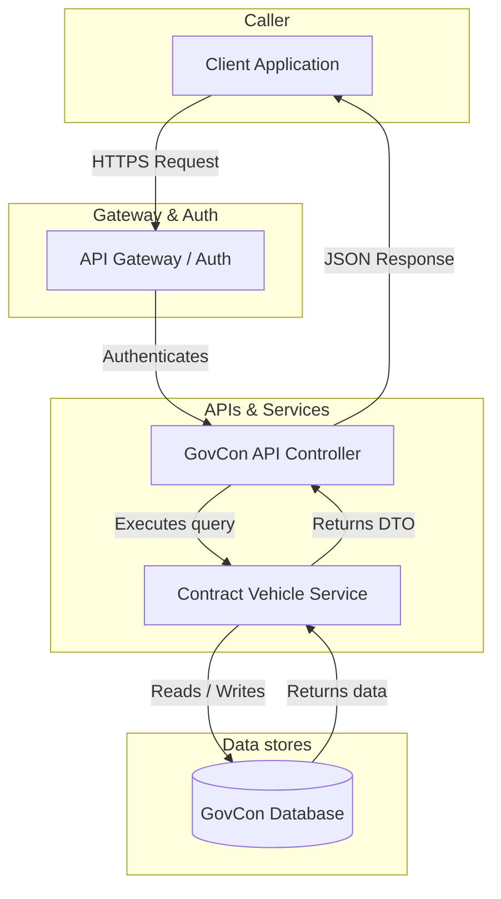

| Property | Value |
| :--- | :--- |
| Deployed as | QA Internal |
| Endpoints | 11 |
| Base path | `https://nl-govcon-agency-api-qa-internal.nlproducts.net` |

## Architecture



## Configuration

- Headers: Requires standard authorization tokens via API Gateway.
- Secrets: Managed securely via environment-specific secrets vaults.

## Data

- Schemas: `DataList`, `IDVGroupInput`, `ContractVehicleInput`, `Wrapper`

## Endpoints

### POST `/api/contract/v1/vendors`

Fetch top vendors for a given contract vehicle program based on total award amount.

**Parameters**

| Name | Location | Type | Required | Description |
| :--- | :--- | :--- | :--- | :--- |
| `program_acronym` | query | string | Yes | Program acronym to search vendors for |
| `page` | query | integer(int32) | Yes | Page number |
| `limit` | query | integer(int32) | Yes | Number of records per page |

**Response (200 OK)**

```json
{
  "success": true,
  "data": [
    {
      "vendor_name": "ACME Defense Corp",
      "uei": "ABC123XYZ789",
      "total_award_amount": 125000000.00
    }
  ],
  "page": 1,
  "limit": 10,
  "total_records": 1
}
```

---

### POST `/api/contract/v1/vehicles`

Search IDV Group data based on ceiling range criteria.

**Parameters**

| Name | Location | Type | Required | Description |
| :--- | :--- | :--- | :--- | :--- |
| `page` | query | integer(int32) | Yes | Page number |
| `limit` | query | integer(int32) | Yes | Number of records per page |

**Request Body**

```json
{
  "min_ceiling": 1000000,
  "max_ceiling": 50000000
}
```

**Response (200 OK)**

```json
{
  "success": true,
  "data": [
    {
      "idv_group": "IDV-Group-Alpha",
      "ceiling": 25000000
    }
  ],
  "page": 1,
  "limit": 10
}
```

---

### POST `/api/contract/v1/contracts`

Search contract vehicle records based on input filters like parent vendor name etc.

**Parameters**

| Name | Location | Type | Required | Description |
| :--- | :--- | :--- | :--- | :--- |
| `page` | query | integer(int32) | Yes | Page number |
| `limit` | query | integer(int32) | Yes | Number of records per page |

**Request Body**

```json
{
  "parent_vendor_name": "Global Tech Solutions"
}
```

**Response (200 OK)**

```json
{
  "success": true,
  "data": [
    {
      "contract_number": "GS-35F-0119Y",
      "title": "IT Schedule 70"
    }
  ]
}
```

---

### POST `/api/contract/v1/contract-awardees`

Get the list of contract awardees under a given contract vehicle program.

**Parameters**

| Name | Location | Type | Required | Description |
| :--- | :--- | :--- | :--- | :--- |
| `program_acronym` | query | string | Yes | Program acronym to fetch awardees for |
| `page` | query | integer(int32) | Yes | Page number |
| `limit` | query | integer(int32) | Yes | Number of records per page |

**Response (200 OK)**

```json
{
  "success": true,
  "data": [
    {
      "awardee_name": "Federal Integrators LLC",
      "uei": "DEF456UVW123"
    }
  ]
}
```

---

### GET `/api/contract/v1/vendor/{uei}/contracts`

Get distinct contract number, key and title for a vendor by UEI.

**Parameters**

| Name | Location | Type | Required | Description |
| :--- | :--- | :--- | :--- | :--- |
| `uei` | path | string | Yes | Vendor UEI |

**Response (200 OK)**

```json
{
  "success": true,
  "data": {
    "uei": "ABC123XYZ789",
    "contracts": [
      {
        "contract_number": "N00178-20-D-4000",
        "contract_key": "KEY-9988",
        "title": "Seaport-NxG"
      }
    ]
  }
}
```

---

### GET `/api/contract/v1/vehicle`

Fetch IDV Group details for a given group key.

**Parameters**

| Name | Location | Type | Required | Description |
| :--- | :--- | :--- | :--- | :--- |
| `idv_group` | query | string | Yes | Group key identifier |

**Response (200 OK)**

```json
{
  "success": true,
  "data": [
    {
      "idv_group": "KEY-9988",
      "description": "Seaport Next Generation IDV"
    }
  ]
}
```

---

### GET `/api/contract/v1/vehicle/classification`

Get contract vehicle classification.

**Parameters**

| Name | Location | Type | Required | Description |
| :--- | :--- | :--- | :--- | :--- |
| `idv_group` | query | string | Yes | contract key |

**Response (200 OK)**

```json
{
  "success": true,
  "data": {
    "classification": "Multi-Agency Contract"
  }
}
```

---

### GET `/api/contract/v1/top/vehicle/agencies`

Get top agency contract vehicle.

**Parameters**

| Name | Location | Type | Required | Description |
| :--- | :--- | :--- | :--- | :--- |
| `idv_group` | query | string | Yes | contract key |

**Response (200 OK)**

```json
{
  "success": true,
  "data": [
    {
      "agency_name": "Department of Defense",
      "total_obligations": 50000000.00
    }
  ]
}
```

---

### GET `/api/contract/v1/top/contract-vehicle`

Get top contract vehicle.

**Parameters**

| Name | Location | Type | Required | Description |
| :--- | :--- | :--- | :--- | :--- |
| `uei` | query | string | Yes | recipient uei |

**Response (200 OK)**

```json
{
  "success": true,
  "data": {
    "top_vehicle": "Alliant 2",
    "uei": "ABC123XYZ789"
  }
}
```

---

### GET `/api/contract/v1/contract`

Fetch contract vehicle details using the Procurement Instrument Identifier (PIID).

**Parameters**

| Name | Location | Type | Required | Description |
| :--- | :--- | :--- | :--- | :--- |
| `piid` | query | string | Yes | Procurement Instrument Identifier (PIID) |

**Response (200 OK)**

```json
{
  "success": true,
  "data": [
    {
      "piid": "GS00Q14OADU111",
      "status": "Active"
    }
  ]
}
```

---

### GET `/api/contract/v1/agency-summary`

Group contract vehicle data by contract key and title, showing total obligations and record count.

**Parameters**

| Name | Location | Type | Required | Description |
| :--- | :--- | :--- | :--- | :--- |
| `funding_org_key` | query | integer(int32) | Yes | Funding agency top-tier org key |
| `page` | query | integer(int32) | Yes | Page number |
| `limit` | query | integer(int32) | Yes | Number of records per page |

**Response (200 OK)**

```json
{
  "success": true,
  "data": [
    {
      "contract_key": "KEY-1234",
      "title": "OASIS",
      "total_obligations": 12000000.00,
      "record_count": 45
    }
  ],
  "page": 1,
  "limit": 10
}
```
