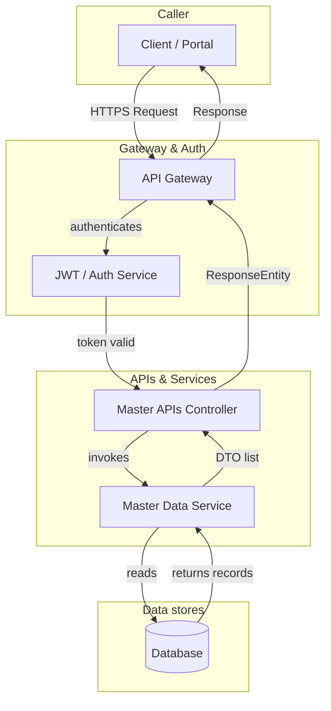

| Property | Value |
| :--- | :--- |
| Deployed as | GovCon API |
| Endpoints | 15 |
| Base path | `https://nl-govcon-agency-api-qa-internal.nlproducts.net` |

:::note
This reference covers Part 1 of the Master APIs. Additional items continue in Part 2.
:::

## Architecture



## Configuration

- Headers: `Authorization: Bearer <token>` required for all endpoints.
- Secrets: Managed securely via environment variable injection at the API Gateway layer.

## Data

- Response schema: `Wrapper` containing pagination metadata and data payloads.

## Endpoints

### GET /api/master/v1/type

Retrieve Award Type master list.

Retrieves the list of award types. Supports optional keyword-based searching using the specified search option (`EXACT`, `STARTS_WITH`, `ENDS_WITH`, or `CONTAINS`). If no keyword is provided, all award types are returned.

#### Parameters

| Name | Location | Type | Required | Description |
| :--- | :--- | :--- | :--- | :--- |
| `keyword` | query | string | No | Search keyword |
| `search_option` | query | string | No | Search filter option |

#### Example Request

```bash
curl -X GET "https://nl-govcon-agency-api-qa-internal.nlproducts.net/api/master/v1/type?keyword=fixed&search_option=CONTAINS" \
  -H "Authorization: Bearer eyJhbGciOi..."
```

#### Example Response

```json
{
  "success": true,
  "status": 200,
  "message": "Award types retrieved successfully",
  "data": [
    {
      "id": "1",
      "code": "FIXED_PRICE",
      "description": "Firm Fixed Price"
    }
  ]
}
```

---

### GET /api/master/v1/solicitation-number

Retrieve Solicitation Number master list.

Retrieves the list of solicitation numbers. Supports optional keyword-based searching using the specified search option (`EXACT`, `STARTS_WITH`, `ENDS_WITH`, or `CONTAINS`). If no keyword is provided, all solicitation numbers are returned.

#### Parameters

| Name | Location | Type | Required | Description |
| :--- | :--- | :--- | :--- | :--- |
| `keyword` | query | string | No | Search keyword |
| `search_option` | query | string | No | Search filter option |

#### Example Request

```bash
curl -X GET "https://nl-govcon-agency-api-qa-internal.nlproducts.net/api/master/v1/solicitation-number" \
  -H "Authorization: Bearer eyJhbGciOi..."
```

#### Example Response

```json
{
  "success": true,
  "status": 200,
  "message": "Solicitation numbers retrieved successfully",
  "data": [
    {
      "solicitationNumber": "W912HQ-23-R-0001"
    }
  ]
}
```

---

### GET /api/master/v1/set-aside

Retrieve Set-Aside master list.

Retrieves the list of set-asides. Supports optional keyword-based searching using the specified search option (`EXACT`, `STARTS_WITH`, `ENDS_WITH`, or `CONTAINS`). If no keyword is provided, all set-asides are returned.

#### Parameters

| Name | Location | Type | Required | Description |
| :--- | :--- | :--- | :--- | :--- |
| `keyword` | query | string | No | Search keyword |
| `search_option` | query | string | No | Search filter option |

#### Example Request

```bash
curl -X GET "https://nl-govcon-agency-api-qa-internal.nlproducts.net/api/master/v1/set-aside" \
  -H "Authorization: Bearer eyJhbGciOi..."
```

#### Example Response

```json
{
  "success": true,
  "status": 200,
  "message": "Set-asides retrieved successfully",
  "data": [
    {
      "code": "SBA",
      "description": "Small Business Administration Set-Aside"
    }
  ]
}
```

---

### GET /api/master/v1/self-certification

Retrieve self certification master list.

Retrieves the list of self certification. Supports optional keyword-based searching using the specified search option (`EXACT`, `STARTS_WITH`, `ENDS_WITH`, or `CONTAINS`). If no keyword is provided, all contract key are returned.

#### Parameters

| Name | Location | Type | Required | Description |
| :--- | :--- | :--- | :--- | :--- |
| `keyword` | query | string | No | Search keyword |
| `search_option` | query | string | No | Search filter option |

#### Example Request

```bash
curl -X GET "https://nl-govcon-agency-api-qa-internal.nlproducts.net/api/master/v1/self-certification" \
  -H "Authorization: Bearer eyJhbGciOi..."
```

#### Example Response

```json
{
  "success": true,
  "status": 200,
  "message": "Self certifications retrieved successfully",
  "data": [
    {
      "certification": "WOSB"
    }
  ]
}
```

---

### GET /api/master/v1/recipient

Retrieve Recipient master list.

Retrieves the list of recipients. With search_option `CONTAINS`, `STARTS_WITH`, `PREFIX`, `FUZZY`, `PHRASE` or `ALL` the keyword is a typeahead search: the last word matches as a prefix, words may contain typos, a full UEI matches exactly, and results are ranked best first with larger award totals ahead. `EXACT`, `ENDS_WITH` and the other options keep their literal SQL meaning. `page` (0-based) and `limit` page the results; without a limit up to 1000 rows are returned. If no keyword is provided, the recipients with the largest award totals come first.

#### Parameters

| Name | Location | Type | Required | Description |
| :--- | :--- | :--- | :--- | :--- |
| `keyword` | query | string | No | Search keyword |
| `search_option` | query | string | No | Search filter option |
| `page` | query | integer(int32) | No | Page index (0-based) |
| `limit` | query | integer(int32) | No | Row limit |

#### Example Request

```bash
curl -X GET "https://nl-govcon-agency-api-qa-internal.nlproducts.net/api/master/v1/recipient?page=0&limit=10" \
  -H "Authorization: Bearer eyJhbGciOi..."
```

#### Example Response

```json
{
  "success": true,
  "status": 200,
  "message": "Recipients retrieved successfully",
  "data": [
    {
      "uei": "ABC123XYZ",
      "name": "Acme Corp",
      "awardTotal": 1500000.00
    }
  ]
}
```

---

### GET /api/master/v1/psc

Retrieve PSC master list.

Retrieves the list of PSC (Product Service Code) identifiers and descriptions. With search_option `CONTAINS`, `STARTS_WITH`, `PREFIX`, `FUZZY`, `PHRASE` or `ALL` the keyword is a typeahead search: a partly typed code containing a digit lists the codes that start with it; words match the short and full PSC names in any order, the last word as a prefix and with typos allowed. `EXACT`, `ENDS_WITH` and the other options keep their literal SQL meaning. `page` (0-based) and `limit` page the results; without a limit up to 1000 rows are returned.

#### Parameters

| Name | Location | Type | Required | Description |
| :--- | :--- | :--- | :--- | :--- |
| `keyword` | query | string | No | Search keyword |
| `search_option` | query | string | No | Search filter option |
| `page` | query | integer(int32) | No | Page index (0-based) |
| `limit` | query | integer(int32) | No | Row limit |

#### Example Request

```bash
curl -X GET "https://nl-govcon-agency-api-qa-internal.nlproducts.net/api/master/v1/psc?keyword=R4" \
  -H "Authorization: Bearer eyJhbGciOi..."
```

#### Example Response

```json
{
  "success": true,
  "status": 200,
  "message": "PSC codes retrieved successfully",
  "data": [
    {
      "code": "R425",
      "description": "Support- Professional: Engineering/Technical"
    }
  ]
}
```

---

### GET /api/master/v1/offices

Retrieve Awarding Office master list.

Retrieves the list of awarding offices. Supports optional keyword-based searching using the specified search option (`EXACT`, `STARTS_WITH`, `ENDS_WITH`, or `CONTAINS`). If no keyword is provided, all awarding offices are returned.

#### Parameters

| Name | Location | Type | Required | Description |
| :--- | :--- | :--- | :--- | :--- |
| `keyword` | query | string | No | Search keyword |
| `search_option` | query | string | No | Search filter option |

#### Example Request

```bash
curl -X GET "https://nl-govcon-agency-api-qa-internal.nlproducts.net/api/master/v1/offices" \
  -H "Authorization: Bearer eyJhbGciOi..."
```

#### Example Response

```json
{
  "success": true,
  "status": 200,
  "message": "Awarding offices retrieved successfully",
  "data": [
    {
      "officeCode": "W912",
      "officeName": "Army Corps of Engineers"
    }
  ]
}
```

---

### GET /api/master/v1/naics

Retrieve NAICS master list.

Retrieves the list of NAICS (North American Industry Classification System) codes and descriptions. With search_option `CONTAINS`, `STARTS_WITH`, `PREFIX`, `FUZZY`, `PHRASE` or `ALL` the keyword is a typeahead search: a partly typed code lists the codes that start with it, shortest first; words match the description in any order, the last word as a prefix and with typos allowed, six-digit industries ranked first. `EXACT`, `ENDS_WITH` and the other options keep their literal SQL meaning. `page` (0-based) and `limit` page the results; without a limit up to 1000 rows are returned.

#### Parameters

| Name | Location | Type | Required | Description |
| :--- | :--- | :--- | :--- | :--- |
| `keyword` | query | string | No | Search keyword |
| `search_option` | query | string | No | Search filter option |
| `page` | query | integer(int32) | No | Page index (0-based) |
| `limit` | query | integer(int32) | No | Row limit |

#### Example Request

```bash
curl -X GET "https://nl-govcon-agency-api-qa-internal.nlproducts.net/api/master/v1/naics?keyword=5415" \
  -H "Authorization: Bearer eyJhbGciOi..."
```

#### Example Response

```json
{
  "success": true,
  "status": 200,
  "message": "NAICS codes retrieved successfully",
  "data": [
    {
      "code": "541512",
      "description": "Computer Systems Design Services"
    }
  ]
}
```

---

### GET /api/master/v1/industry

Retrieve self industry master list.

Retrieves the list of industry. Supports optional keyword-based searching using the specified search option (`EXACT`, `STARTS_WITH`, `ENDS_WITH`, or `CONTAINS`). If no keyword is provided, all contract key are returned.

#### Parameters

| Name | Location | Type | Required | Description |
| :--- | :--- | :--- | :--- | :--- |
| `keyword` | query | string | No | Search keyword |
| `search_option` | query | string | No | Search filter option |

#### Example Request

```bash
curl -X GET "https://nl-govcon-agency-api-qa-internal.nlproducts.net/api/master/v1/industry" \
  -H "Authorization: Bearer eyJhbGciOi..."
```

#### Example Response

```json
{
  "success": true,
  "status": 200,
  "message": "Industries retrieved successfully",
  "data": [
    {
      "industry": "Information Technology"
    }
  ]
}
```

---

### GET /api/master/v1/contract-vehicle

Retrieve Contract Vehicle master list.

Retrieves the list of contract vehicles. Supports optional keyword-based searching using the specified search option (`EXACT`, `STARTS_WITH`, `ENDS_WITH`, or `CONTAINS`). If no keyword is provided, all contract vehicles are returned.

#### Parameters

| Name | Location | Type | Required | Description |
| :--- | :--- | :--- | :--- | :--- |
| `keyword` | query | string | No | Search keyword |
| `search_option` | query | string | No | Search filter option |

#### Example Request

```bash
curl -X GET "https://nl-govcon-agency-api-qa-internal.nlproducts.net/api/master/v1/contract-vehicle" \
  -H "Authorization: Bearer eyJhbGciOi..."
```

#### Example Response

```json
{
  "success": true,
  "status": 200,
  "message": "Contract vehicles retrieved successfully",
  "data": [
    {
      "vehicleName": "SEWP V"
    }
  ]
}
```

---

### GET /api/master/v1/contract-number

Retrieve Contract Number master list.

Retrieves the list of contract numbers. Supports optional keyword-based searching using the specified search option (`EXACT`, `STARTS_WITH`, `ENDS_WITH`, or `CONTAINS`). If no keyword is provided, all contract numbers are returned.

#### Parameters

| Name | Location | Type | Required | Description |
| :--- | :--- | :--- | :--- | :--- |
| `keyword` | query | string | No | Search keyword |
| `search_option` | query | string | No | Search filter option |

#### Example Request

```bash
curl -X GET "https://nl-govcon-agency-api-qa-internal.nlproducts.net/api/master/v1/contract-number" \
  -H "Authorization: Bearer eyJhbGciOi..."
```

#### Example Response

```json
{
  "success": true,
  "status": 200,
  "message": "Contract numbers retrieved successfully",
  "data": [
    {
      "contractNumber": "GS-35F-0114Y"
    }
  ]
}
```

---

### GET /api/master/v1/contract-key

Retrieve Contract key master list.

Retrieves the list of contract key. Supports optional keyword-based searching using the specified search option (`EXACT`, `STARTS_WITH`, `ENDS_WITH`, or `CONTAINS`). If no keyword is provided, all contract key are returned.

#### Parameters

| Name | Location | Type | Required | Description |
| :--- | :--- | :--- | :--- | :--- |
| `keyword` | query | string | No | Search keyword |
| `search_option` | query | string | No | Search filter option |

#### Example Request

```bash
curl -X GET "https://nl-govcon-agency-api-qa-internal.nlproducts.net/api/master/v1/contract-key" \
  -H "Authorization: Bearer eyJhbGciOi..."
```

#### Example Response

```json
{
  "success": true,
  "status": 200,
  "message": "Contract keys retrieved successfully",
  "data": [
    {
      "contractKey": "CK-9876"
    }
  ]
}
```

---

### GET /api/master/v1/certification

Retrieve certification master list.

Retrieves the list of certification. Supports optional keyword-based searching using the specified search option (`EXACT`, `STARTS_WITH`, `ENDS_WITH`, or `CONTAINS`). If no keyword is provided, all contract key are returned.

#### Parameters

| Name | Location | Type | Required | Description |
| :--- | :--- | :--- | :--- | :--- |
| `keyword` | query | string | No | Search keyword |
| `search_option` | query | string | No | Search filter option |

#### Example Request

```bash
curl -X GET "https://nl-govcon-agency-api-qa-internal.nlproducts.net/api/master/v1/certification" \
  -H "Authorization: Bearer eyJhbGciOi..."
```

#### Example Response

```json
{
  "success": true,
  "status": 200,
  "message": "Certifications retrieved successfully",
  "data": [
    {
      "certification": "ISO 9001"
    }
  ]
}
```

---

### GET /api/master/v1/cage-code

Retrieve cage code master list.

Retrieves the list of cage code. Supports optional keyword-based searching using the specified search option (`EXACT`, `STARTS_WITH`, `ENDS_WITH`, or `CONTAINS`). If no keyword is provided, all ccage code are returned.

#### Parameters

| Name | Location | Type | Required | Description |
| :--- | :--- | :--- | :--- | :--- |
| `keyword` | query | string | No | Search keyword |
| `search_option` | query | string | No | Search filter option |

#### Example Request

```bash
curl -X GET "https://nl-govcon-agency-api-qa-internal.nlproducts.net/api/master/v1/cage-code" \
  -H "Authorization: Bearer eyJhbGciOi..."
```

#### Example Response

```json
{
  "success": true,
  "status": 200,
  "message": "Cage codes retrieved successfully",
  "data": [
    {
      "cageCode": "3V502"
    }
  ]
}
```

---

### GET /api/master/v1/business-type

Retrieve Business Type master list.

Retrieves the list of business types. Supports optional keyword-based searching using the specified search option (`EXACT`, `STARTS_WITH`, `ENDS_WITH`, or `CONTAINS`). If no keyword is provided, all business types are returned.

#### Parameters

| Name | Location | Type | Required | Description |
| :--- | :--- | :--- | :--- | :--- |
| `keyword` | query | string | No | Search keyword |
| `search_option` | query | string | No | Search filter option |

#### Example Request

```bash
curl -X GET "https://nl-govcon-agency-api-qa-internal.nlproducts.net/api/master/v1/business-type" \
  -H "Authorization: Bearer eyJhbGciOi..."
```

#### Example Response

```json
{
  "success": true,
  "status": 200,
  "message": "Business types retrieved successfully",
  "data": [
    {
      "code": "SMALL_BUSINESS",
      "description": "Small Business Concern"
    }
  ]
}
```
