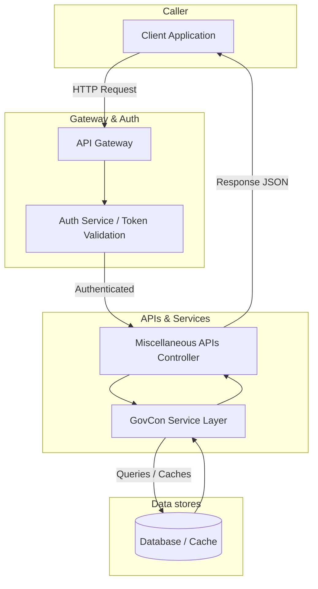

description: "Reference documentation for GovCon API miscellaneous lookup and resolution endpoints."

| Property | Value |
| :--- | :--- |
| Deployed as | GovCon API |
| Endpoints | 10 |
| Base path | `https://nl-govcon-agency-api-qa-internal.nlproducts.net` |

## Architecture



## Data

- Authentication required: All endpoints require valid authentication headers (Bearer token).
- Request payloads: Standard JSON inputs (`SicInput`, `PscInput`, `NaicsInput`) or query string parameters.
- Response formats: `DataList` or `Wrapper` schemas containing the requested classification codes, hierarchies, or resolution metadata.

## Endpoints

### POST /api/misc/v1/sic

Get SIC records

Fetches a paginated list of SIC records (Standard Industrial Classification).

#### Parameters

| Name | Location | Type | Required | Description |
| :--- | :--- | :--- | :--- | :--- |
| `page` | query | integer(int32) | Yes | Page number |
| `limit` | query | integer(int32) | Yes | Items per page |

#### Request Example

```json
{
  "search_term": "technology"
}
```

#### Response Example (`200 OK`)

```json
{
  "status": {
    "code": 200,
    "message": "SUCCESS"
  },
  "data": [
    {
      "code": "7371",
      "description": "Computer Programming Services"
    }
  ]
}
```

---

### POST /api/misc/v1/psc

Get all PSC entries with full metadata

#### Parameters

| Name | Location | Type | Required | Description |
| :--- | :--- | :--- | :--- | :--- |
| `page` | query | integer(int32) | No | Page number |
| `limit` | query | integer(int32) | No | Items per page |

#### Request Example

```json
{
  "category": "R"
}
```

#### Response Example (`200 OK`)

```json
{
  "status": {
    "code": 200,
    "message": "SUCCESS"
  },
  "data": [
    {
      "id": "R425",
      "psc_full_name": "Support- Professional: Engineering/Technical"
    }
  ]
}
```

---

### POST /api/misc/v1/naics/categories

Get all unique NAICS codes and descriptions

#### Parameters

| Name | Location | Type | Required | Description |
| :--- | :--- | :--- | :--- | :--- |
| `is_autocomplete` | query | boolean | No | Enable autocomplete filtering |
| `page` | query | integer(int32) | Yes | Page number |
| `limit` | query | integer(int32) | Yes | Items per page |

#### Request Example

```json
{
  "query": "541"
}
```

#### Response Example (`200 OK`)

```json
{
  "status": {
    "code": 200,
    "message": "SUCCESS"
  },
  "data": [
    {
      "naics_code": "541512",
      "description": "Computer Systems Design Services"
    }
  ]
}
```

---

### POST /api/misc/v1/business-types

Get distinct business types

Fetches a list of all unique business types of vendors.

#### Parameters

| Name | Location | Type | Required | Description |
| :--- | :--- | :--- | :--- | :--- |
| `page` | query | integer(int32) | Yes | Page number |
| `limit` | query | integer(int32) | Yes | Items per page |

#### Response Example (`200 OK`)

```json
{
  "status": {
    "code": 200,
    "message": "SUCCESS"
  },
  "data": [
    "Small Business",
    "Woman Owned Small Business"
  ]
}
```

---

### GET /api/misc/v1/psc/hierarchy

Get psc hierarchy

Fetches a psc hierarchy.

#### Response Example (`200 OK`)

```json
{
  "status": {
    "code": 200,
    "message": "SUCCESS"
  },
  "data": {
    "id": "R",
    "name": "Support (Professional/Administrative/Support)",
    "children": []
  }
}
```

---

### GET /api/misc/v1/psc/categories/detailed

Get unique PSC categories with IDs and full names

Returns unique Level 1 and Level 2 PSC category combinations along with PSC entries containing both id and psc_full_name.

#### Parameters

| Name | Location | Type | Required | Description |
| :--- | :--- | :--- | :--- | :--- |
| `page` | query | integer(int32) | Yes | Page number |
| `limit` | query | integer(int32) | Yes | Items per page |

#### Response Example (`200 OK`)

```json
{
  "status": {
    "code": 200,
    "message": "SUCCESS"
  },
  "data": [
    {
      "id": "R425",
      "psc_full_name": "Support- Professional: Engineering/Technical"
    }
  ]
}
```

---

### GET /api/misc/v1/place-of-performance/resolve

Split a place of performance into structured address parts

Breaks a free-text place of performance into street address, city, state, zip and country. Nothing is looked up in the database; the model completes a partial address from its own knowledge of US postal geography, so a bare ZIP code will fill in its city and state. A street address is never invented - it stays blank unless the input actually contains one.

State is returned both as the full name (e.g. 'Virginia') and as the two-letter USPS code (e.g. 'VA'), the latter matching what `nl_solicitations.pop_state` and `nl_awards.pop_state_code` store. Country is an ISO 3166-1 alpha-3 code (e.g. 'USA'). The result entry is always present; anything the address did not state comes back as an empty string. `status.message` is `NO_MATCH` when nothing could be extracted and `LLM_UNAVAILABLE` when the model is not configured.

#### Parameters

| Name | Location | Type | Required | Description |
| :--- | :--- | :--- | :--- | :--- |
| `address` | query | string | Yes | Place of performance as written |

#### Response Example (`200 OK`)

```json
{
  "status": {
    "code": 200,
    "message": "SUCCESS"
  },
  "data": {
    "street": "",
    "city": "Washington",
    "state": "District of Columbia",
    "state_code": "DC",
    "zip": "20500",
    "country": "USA"
  }
}
```

---

### GET /api/misc/v1/naics/hierarchy

Get NAICS hierarchy and immediate children

Returns the full hierarchy (ancestors) for a given NAICS code, along with the immediate children.

#### Parameters

| Name | Location | Type | Required | Description |
| :--- | :--- | :--- | :--- | :--- |
| `naicsCode` | query | string | Yes | NAICS code for which to fetch hierarchy |
| `page` | query | integer(int32) | No | Page number |
| `limit` | query | integer(int32) | No | Items per page |

#### Response Example (`200 OK`)

```json
{
  "status": {
    "code": 200,
    "message": "SUCCESS"
  },
  "data": {
    "code": "541512",
    "ancestors": ["54", "541", "5415"],
    "children": []
  }
}
```

---

### GET /api/misc/v1/naics/all/hierarchy

Retrieve NAICS hierarchy

Retrieves the complete NAICS (North American Industry Classification System) hierarchy as a tree structure. Each node contains its child NAICS classifications based on the parent-child relationship.

#### Response Example (`200 OK`)

```json
{
  "status": {
    "code": 200,
    "message": "SUCCESS"
  },
  "data": {
    "code": "11",
    "title": "Agriculture, Forestry, Fishing and Hunting",
    "children": []
  }
}
```

---

### GET /api/misc/v1/agency/resolve

Resolve an agency name to its org_key

Resolves a plain-English agency name, short name or code to a single canonical agency. Exact matches are returned directly; otherwise candidates are ranked by lexical similarity and, when the leader is not clear-cut, an LLM picks one from that list. The LLM can only choose an agency that was already retrieved from the database, never invent one.

The result entry is always present. When nothing was resolved its fields are blank and `status.message` is `NO_MATCH` (nothing resembled the input), `AMBIGUOUS` (several equally valid agencies, e.g. the many 'Office of Inspector General' rows - pass the `parent` hint to disambiguate) or `LLM_UNAVAILABLE`.

Resolved lookups are remembered, so repeating a name that once needed the LLM is answered from the cache without a model call. Only the `org_key` is cached: the agency record is always re-read, so a cached answer reflects the current data and is indistinguishable from a freshly resolved one. The cache is keyed on the name together with the `parent` and `include_offices` arguments, and only successful resolutions are kept.

#### Parameters

| Name | Location | Type | Required | Description |
| :--- | :--- | :--- | :--- | :--- |
| `name` | query | string | Yes | Agency name, short name or code |
| `parent` | query | string | No | Optional parent agency hint (name or org_key) used to break ties |
| `include_offices` | query | boolean | No | Widen the search from departments/sub-agencies to contracting offices |

#### Response Example (`200 OK`)

```json
{
  "status": {
    "code": 200,
    "message": "SUCCESS"
  },
  "data": {
    "org_key": "agency-12345",
    "agency_name": "Department of Defense"
  }
}
```
