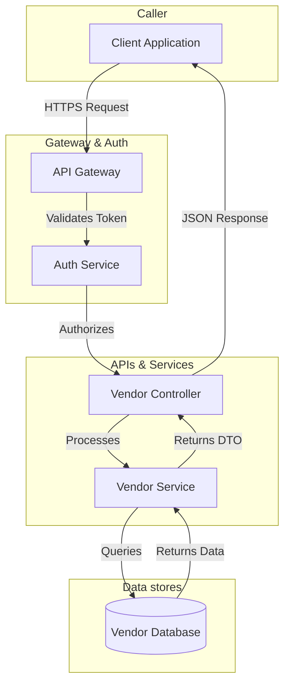

| Property | Value |
| :--- | :--- |
| Deployed as | QA Internal |
| Endpoints | 12 |
| Base path | `https://nl-govcon-agency-api-qa-internal.nlproducts.net` |

## Architecture



## Configuration

- Base URL: `https://nl-govcon-agency-api-qa-internal.nlproducts.net`
- Authentication: Required (`auth_required: true` for all endpoints)

## Data

- Request schemas: `VendorInput`, `SbaEntities`, `PeopleSearchCriteria`
- Response schemas: `DataList`, `Wrapper`

## Endpoints

### POST /api/vendor/v1/vendors

Search for vendors based on filters such as city, state, country, or business keywords.

#### Parameters

| Name | Location | Type | Required | Description |
| :--- | :--- | :--- | :--- | :--- |
| `page` | query | integer(int32) | Yes | Page number |
| `limit` | query | integer(int32) | Yes | Items per page |

#### Example Request

```json
{
  "state": "VA",
  "city": "Arlington",
  "keywords": ["IT Services"]
}
```

#### Example Response

```json
{
  "content": [
    {
      "uei": "ABC123XYZ789",
      "vendor_name": "Example Corp",
      "city": "Arlington",
      "state": "VA",
      "country": "USA"
    }
  ],
  "page": 0,
  "limit": 10,
  "total_elements": 1
}
```

---

### POST /api/vendor/v1/states

Fetch a list of unique states where vendors are located.

#### Parameters

| Name | Location | Type | Required | Description |
| :--- | :--- | :--- | :--- | :--- |
| `page` | query | integer(int32) | Yes | Page number |
| `limit` | query | integer(int32) | Yes | Items per page |

#### Example Response

```json
{
  "content": ["VA", "MD", "DC"],
  "page": 0,
  "limit": 10,
  "total_elements": 3
}
```

---

### GET /api/vendor/v1/sba-entities

Retrieves SBA entity details based on the optional entity_detail_id and UEI parameters.

#### Parameters

| Name | Location | Type | Required | Description |
| :--- | :--- | :--- | :--- | :--- |
| `entity_detail_id` | query | string | No | SBA entity detail identifier |
| `uei` | query | string | No | Unique Entity Identifier |

#### Example Response

```json
{
  "data": {
    "entity_detail_id": "98765",
    "uei": "ABC123XYZ789",
    "sba_certified": true
  }
}
```

---

### POST /api/vendor/v1/sba-entities

Ignores other filters and returns vendors ordered exactly as the UEIs are provided in the request body.

#### Parameters

| Name | Location | Type | Required | Description |
| :--- | :--- | :--- | :--- | :--- |
| `page` | query | integer(int32) | Yes | Page number (0-based) |
| `limit` | query | integer(int32) | Yes | Items per page |

#### Example Request

```json
{
  "ueis": ["ABC123XYZ789", "DEF456UVW321"]
}
```

#### Example Response

```json
{
  "content": [
    {
      "uei": "ABC123XYZ789",
      "name": "Example Corp"
    }
  ],
  "page": 0,
  "limit": 10
}
```

---

### POST /api/vendor/v1/people

Get Vendors people data.

#### Parameters

| Name | Location | Type | Required | Description |
| :--- | :--- | :--- | :--- | :--- |
| `page` | query | integer(int32) | Yes | Page number (0-based) |
| `limit` | query | integer(int32) | Yes | Items per page |

#### Example Request

```json
{
  "uei": "ABC123XYZ789",
  "role": "Point of Contact"
}
```

#### Example Response

```json
{
  "content": [
    {
      "name": "John Doe",
      "email": "john.doe@example.com",
      "title": "Contract Manager"
    }
  ],
  "page": 0,
  "limit": 10
}
```

---

### POST /api/vendor/v1/ordered-vendors

Ignores other filters and returns vendors ordered exactly as the UEIs are provided in the request body.

#### Parameters

| Name | Location | Type | Required | Description |
| :--- | :--- | :--- | :--- | :--- |
| `page` | query | integer(int32) | Yes | Page number (0-based) |
| `limit` | query | integer(int32) | Yes | Items per page |

#### Example Request

```json
{
  "ueis": ["ABC123XYZ789", "DEF456UVW321"]
}
```

#### Example Response

```json
{
  "content": [
    {
      "uei": "ABC123XYZ789"
    }
  ],
  "page": 0,
  "limit": 10
}
```

---

### POST /api/vendor/v1/countries

Fetch a list of unique countries where vendors are located.

#### Parameters

| Name | Location | Type | Required | Description |
| :--- | :--- | :--- | :--- | :--- |
| `page` | query | integer(int32) | Yes | Page number |
| `limit` | query | integer(int32) | Yes | Items per page |

#### Example Response

```json
{
  "content": ["USA", "CAN"],
  "page": 0,
  "limit": 10
}
```

---

### POST /api/vendor/v1/cities

Fetch a list of unique cities where vendors are located.

#### Parameters

| Name | Location | Type | Required | Description |
| :--- | :--- | :--- | :--- | :--- |
| `page` | query | integer(int32) | Yes | Page number |
| `limit` | query | integer(int32) | Yes | Items per page |

#### Example Response

```json
{
  "content": ["Arlington", "Washington"],
  "page": 0,
  "limit": 10
}
```

---

### POST /api/vendor/v1/associates

Returns sibling vendors (same parent_uei as input UEI, excluding the input) or child vendors (whose parent_uei matches the input UEI), depending on the relationship type.

#### Parameters

| Name | Location | Type | Required | Description |
| :--- | :--- | :--- | :--- | :--- |
| `uei` | query | string | Yes | UEI of the vendor |
| `type` | query | string | Yes | Relationship type: 'sibling' or 'child' |
| `page` | query | integer(int32) | Yes | Page number |
| `limit` | query | integer(int32) | Yes | Items per page |

#### Example Response

```json
{
  "content": [
    {
      "uei": "CHILD123456",
      "parent_uei": "ABC123XYZ789"
    }
  ],
  "page": 0,
  "limit": 10
}
```

---

### GET /api/vendor/v1/spending-over-time

Get agencies vendor by org key.

#### Parameters

| Name | Location | Type | Required | Description |
| :--- | :--- | :--- | :--- | :--- |
| `uei` | query | string | Yes | Unique Entity Identifier |
| `type` | query | string | Yes | Spending metric type |

#### Example Response

```json
{
  "data": {
    "uei": "ABC123XYZ789",
    "spending": [
      { "year": 2022, "amount": 1500000.00 }
    ]
  }
}
```

---

### GET /api/vendor/v1/last-fy-obligation

Get vendor last fy obligation.

#### Parameters

| Name | Location | Type | Required | Description |
| :--- | :--- | :--- | :--- | :--- |
| `uei` | query | string | Yes | Unique Entity Identifier |

#### Example Response

```json
{
  "data": {
    "uei": "ABC123XYZ789",
    "fiscal_year": 2023,
    "obligation_amount": 500000.00
  }
}
```

---

### GET /api/vendor/v1/detail

Fetch vendor information for the given UEI.

#### Parameters

| Name | Location | Type | Required | Description |
| :--- | :--- | :--- | :--- | :--- |
| `uei` | query | string | Yes | Unique Entity Identifier (UEI) of the vendor |

#### Example Response

```json
{
  "content": [
    {
      "uei": "ABC123XYZ789",
      "legal_business_name": "Example Corp",
      "physical_address": {
        "city": "Arlington",
        "state": "VA",
        "country": "USA"
      }
    }
  ]
}
```
