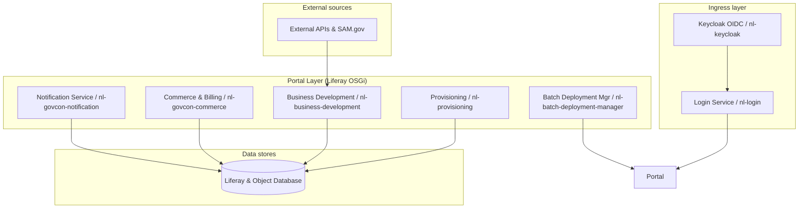

description: "Internal engineering reference documenting the architecture, modules, and service components of GovCon360."

:::warning[INTERNAL]
This page is for engineering and operations. It documents internal services, extensions, and configurations without exposing credentials.
:::

## System overview

The GovCon360 repository comprises 4,527 total files structured across a Liferay modular OSGi architecture. It features 1,243 Java classes (614 custom, 629 generated) distributed among domain modules including business development, headless data services, Keycloak authentication, commerce extensions, batch deployment management, and marketing accelerators. 

## Components and extensions

The following table details the core modules, their component types, and associated technical configurations identified in the repository.

| Component / Module | Type | Friendly URL / Config | OAuth Scopes / Details |
| :--- | :--- | :--- | :--- |
| `modules/commerce/govcon-billing-cron` | OSGi Module / Scheduled Job | `GovConBillingConfiguration` | Manages billing cycles and invoice dispatch tasks via `GovConBillingDispatchTaskExecutor`. |
| `modules/commerce/nl-govcon-commerce` | Headless & Commerce Module | `nl.govcon.headless.commerce.delivery.order` | Custom order validators (`CustomAvailabilityCommerceOrderValidatorImpl`) and billing resource filters. |
| `modules/common/nl-analytics` | OSGi Module | `NlAnalyticsSiteConfiguration` | Injects Google Tag Manager (GTM) scripts and analytics tracking instances. |
| `modules/common/nl-batch-deployment-manager` | OSGi Module / Panel App | `BatchDeploymentConfiguration` | Package inspection, client extension packaging, and task execution monitoring. |
| `modules/common/nl-govcon-account-utils` | OSGi Utility Module | `nl.govcon.account` | Resolves account relationships, internal staff roles, and local object entry queries. |
| `modules/common/nl-govcon-notification` | Notification Module | `EmailSenderConfiguration`, `NlGovconNotificationConfiguration` | Handles email notifications, user alerts, and REST resource endpoints (`NotificationResourceImpl`). |
| `modules/common/nl-keycloak` | Authentication Module | `NlKeycloakConfiguration` | Manages Keycloak realm synchronization, OIDC tokens, and client credentials. |
| `modules/common/nl-login` | Login Module | `OidcLoginRedirectConfiguration`, `HomeURLFilterConfiguration` | Controls OIDC login redirection, manual login bypass rules, and login history cleanup. |
| `modules/common/nl-provisioning` | Provisioning Module | `B2BSsoProvisioningConfiguration`, `ProvisioningAwsConfiguration` | Manages B2B/B2C realm provisioning, AWS DNS/ELB integrations, and Kubernetes namespace settings. |
| `modules/govcon360/nl-business-development` | Business Domain Module | `EnrichmentConfiguration`, `AccountRelationshipEnrichmentConfiguration` | Enrichment handlers for SAM.gov, recompetes, procurement notices, and debug resources. |
| `modules/govcon360/nl-govcon-export-rest-service` | Export Service | `ExportConfiguration` | Rest service handling data exports with limits for Excel, CSV, and PDF formats. |
| `modules/marketing-accelerator/nl-marketing-accelerator` | MarCom Module | `SitemapConfiguration`, `DynamicSitemapEntityConfiguration` | Dynamic sitemap document generation and page metadata configuration. |

## Data and integration points

### Batch and Deployment Services
- **Batch Deployment Manager (`modules/common/nl-batch-deployment-manager`)**: Inspects client extension packages, tracks import task summaries, and stages artifacts for deployment using configurable staging and deployment directories.
- **Billing Cron Jobs (`modules/commerce/govcon-billing-cron`)**: Executes scheduled invoice generation tasks (`InvoiceJob`) and dispatch tasks based on configured invoice due and lead days.

### Identity and Provisioning Integration
- **Keycloak & OIDC (`modules/common/nl-keycloak`, `modules/common/nl-login`)**: Synchronizes organization roles and regular roles through OIDC flows. Enforces login restrictions, default redirection paths, and retention schedules for login history.
- **Client Provisioning (`modules/common/nl-provisioning`)**: Interfaces with AWS Route53 / Elastic Load Balancers (`ProvisioningAwsConfiguration`) and Kubernetes namespaces (`ProvisioningKubernetesConfiguration`) to provision tenant environments dynamically.

### Business Intelligence and Enrichment
- **Business Development Enrichment (`modules/govcon360/nl-business-development`)**: Connects external data providers (including SAM.gov and procurement notice endpoints) with local caching and TTL configurations (`SamGovEnrichmentConfiguration`, `ProcurementNoticeEnrichmentConfiguration`).
