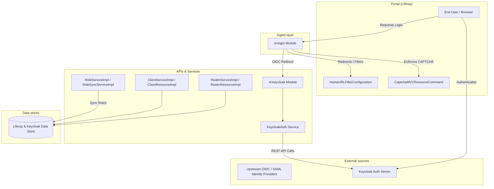

:::warning[INTERNAL]
This page is for engineering and operations. It documents internal services, extensions, and configurations without exposing credentials.
:::

## System overview

The GovCon360 authentication subsystem comprises 4,527 total repository files, centered primarily around two core Java OSGi modules: `modules/common/nl-keycloak` and `modules/common/nl-login`. 

- **`modules/common/nl-keycloak`**: Provides 160 total files (64 custom, 96 generated) containing 48 OSGi components, 14 JAX-RS REST resources, and 3 OSGi configurations. This module handles administrative interactions with Keycloak, tenant realms, clients, users, groups, identity providers (OIDC/SAML), role synchronization, and user profiles.
- **`modules/common/nl-login`**: Provides 28 custom files (0 generated) containing 15 OSGi components, 0 REST resources, and 4 OSGi configurations. This module governs login redirects, CAPTCHA integration (`CaptchaMVCResourceCommand`), home URL filtering, and login history cleanup scheduling.
- **`modules/common/nl-provisioning`**: Contributes core B2B SSO provisioning configurations and OAuth2 scope definitions.

## Components and extensions

The authentication framework relies on multiple OSGi components, configuration interfaces, and REST resource implementations.

| Component | Type | Friendly URL / Config | OAuth Scopes / Details |
| :--- | :--- | :--- | :--- |
| `NlKeycloakConfiguration` | Interface (`Meta.OCD`) | `nl.govcon.keycloak.configuration` | Server URL, admin realm, client credentials, and B2B provisioning flags. |
| `NlKeycloakRealmConfiguration` | Interface (`Meta.OCD`) | `nl.govcon.keycloak.configuration` | SMTP host, port, credentials, and sender display name settings per realm. |
| `RoleSyncConfiguration` | Interface (`Meta.OCD`) | `nl.govcon.keycloak.oidc.internal` | Regular roles and organization roles synchronization settings. |
| `HomeURLFilterConfiguration` | Interface (`Meta.OCD`) | `nl.login.configuration` | Default redirect URL configuration post-login. |
| `LoginHistoryCleanupConfiguration` | Interface (`Meta.OCD`) | `nl.login.configuration` | Retention days, cron expression, and batch size for cleanup routines. |
| `OidcLoginRedirectConfiguration` | Interface (`Meta.OCD`) | `nl.login.configuration` | Provider name, login friendly URLs, excluded groups, and manual login bypass. |
| `ProvisioningPostLoginConfiguration` | Interface (`Meta.OCD`) | `nl.login.configuration` | Post-login redirect path handling. |
| `B2BSsoProvisioningConfiguration` | Interface (`Meta.OCD`) | `nl.client.provisioning.core.configuration` | Environment key, label, realm/client prefixes, and shared B2C realm. |
| `GovconOAuth2ScopeConfiguration` | Interface (`Meta.OCD`) | `nl.client.provisioning.core.configuration` | Supported OAuth2 scopes array definition. |
| `BrandingResourceImpl` | Class (`Component`) | `nl.keycloak.realm.rest.internal` | REST resource handling realm branding updates (`updateRealmBranding`). |
| `ClientResourceImpl` | Class (`Component`) | `nl.keycloak.client.rest.internal` | REST resource managing realm clients, client roles, and offline sessions. |
| `GroupResourceImpl` | Class (`Component`) | `nl.keycloak.client.rest.internal` | REST resource managing realm groups, members, and details. |
| `IdentityProviderResourceImpl` | Class (`Component`) | `nl.keycloak.realm.rest.internal` | REST resource for upstream OIDC and SAML identity provider management. |
| `OidcConnectionResourceImpl` | Class (`Component`) | `nl.keycloak.oidc.rest.internal` | REST resource for OIDC connection configuration and verification. |
| `RealmResourceImpl` | Class (`Component`) | `nl.keycloak.realm.rest.internal` | REST resource for tenant realm lifecycle and SMTP configurations. |
| `RoleResourceImpl` | Class (`Component`) | `nl.keycloak.client.rest.internal` | REST resource managing realm roles and updates. |
| `UserProfileResourceImpl` | Class (`Component`) | `nl.keycloak.realm.rest.internal` | REST resource retrieving and updating user profile attributes. |
| `UserResourceImpl` | Class (`Component`) | `nl.keycloak.user.rest.internal` | REST resource handling user creation, password resets, and role assignments. |
| `CaptchaMVCResourceCommand` | Class (`Component`) | `nl.login.portlet.actions` | MVC resource command serving login CAPTCHA challenges. |

## Data and integration points

### Batch Definitions and Scheduled Tasks
- **`RoleSyncScheduler`**: Executes asynchronous triggers for syncing Liferay roles and organization roles based on configured intervals.
- **`LoginHistoryCleanupConfiguration`**: Governs batch-based retention cleanup of login history logs via configurable cron expressions and batch sizes (`batchSize`, `retentionDays`).

### OAuth Applications and Identity Providers
- **Upstream Identity Providers**: Supported through `IdentityProviderResourceImpl` and `RealmServiceImpl`, enabling dynamic integration with external OIDC and SAML providers.
- **`KeycloakAuth`**: Centralized HTTP execution client handling checked JSON requests, array results, and token-authenticated communication against the Keycloak admin API.
- **Role Synchronization**: Managed via `RoleSyncServiceImpl`, `RoleSyncPostLoginAction`, and `UserRoleModelListener`, ensuring bidirectional role consistency between Keycloak identity assertions and Liferay portal roles.
