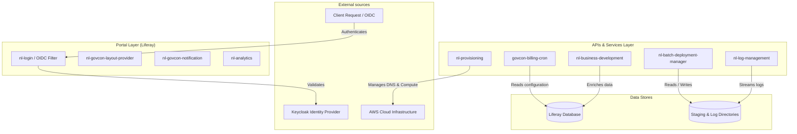

:::warning[INTERNAL]
This page is for engineering and operations. It documents internal services, extensions, and configurations without exposing credentials.
:::

## System overview

The GovCon360 infrastructure codebase consists of 4,527 total files partitioned across several specialized Liferay and OSGi modules. The architecture handles core platform provisioning (`nl-provisioning`), batch and client extension deployments (`nl-batch-deployment-manager`), layout routing (`nl-govcon-layout-provider`), logging operations (`nl-log-management`), analytics tracking (`nl-analytics`), billing cron jobs (`govcon-billing-cron`), and business development services.

## Components and extensions

The table below catalogs key Java classes, configurations (OCD), and OSGi components discovered across the modules.

| Component | Type | Friendly URL / Config | OAuth Scopes / Details |
| :--- | :--- | :--- | :--- |
| `GovConBillingConfigurationResource` | `@Component`, `@Path` | `modules/commerce/govcon-billing-cron` | Exposes billing configuration endpoints via JAX-RS. |
| `GovConBillingConfiguration` | `@ExtendedObjectClassDefinition`, `@Meta.OCD` | `com.govcon.billing.configuration` | Defines `invoiceDueDays()` and `invoiceLeadDays()` settings. |
| `NlAnalytics` | `@Component` | `modules/common/nl-analytics` | Manages Google Tag Manager script injection and site tracking. |
| `NlAnalyticsInstanceConfiguration` | `@ExtendedObjectClassDefinition`, `@Meta.OCD` | `nl.analytics.configuration` | Global instance toggle and GTM HTML template. |
| `NlAnalyticsSiteConfiguration` | `@ExtendedObjectClassDefinition`, `@Meta.OCD` | `nl.analytics.configuration` | Per-site GTM configuration parameters (`gtmId`). |
| `BatchDeploymentConfiguration` | `@ExtendedObjectClassDefinition`, `@Meta.OCD` | `nl.batch.deployment.manager.configuration` | Manages `stagingDirectory()`, `deploymentDirectory()`, and task limits. |
| `ClientExtensionPackageService` | `@Component` | `nl.batch.deployment.manager.service` | Handles package inventory, inspection, and deployment routines. |
| `DeployPackageMVCResourceCommand` | `@Component` | `nl.batch.deployment.manager.resource` | MVC resource command for executing package deployment actions. |
| `EmailSenderConfiguration` | `@ExtendedObjectClassDefinition`, `@Meta.OCD` | `nl.govcon.notification.core.configuration` | Controls sender address, attachment size limits, and role permissions. |
| `NlKeycloakConfiguration` | `@ExtendedObjectClassDefinition`, `@Meta.OCD` | `nl.govcon.keycloak.configuration` | Configures Keycloak server URL, admin realm, and client credentials. |
| `LogManagementConfiguration` | `@ExtendedObjectClassDefinition`, `@Meta.OCD` | `nl.log.management.configuration` | Configures Liferay home directory, log suffixes, and preview chunks. |
| `LogDownloadMVCResourceCommand` | `@Component` | `nl.log.management.resource` | Streams individual log files and previews for authorized administrators. |
| `OidcLoginRedirectConfiguration` | `@ExtendedObjectClassDefinition`, `@Meta.OCD` | `nl.login.configuration` | Controls OIDC redirection paths, provider names, and bypass toggles. |
| `B2BSsoProvisioningConfiguration` | `@ExtendedObjectClassDefinition`, `@Meta.OCD` | `nl.client.provisioning.core.configuration` | Defines tenant provisioning keys, realm prefixes, and group defaults. |
| `ProvisioningAwsConfiguration` | `@ExtendedObjectClassDefinition`, `@Meta.OCD` | `nl.aws.core.configuration` | Manages AWS Route53/ELB zones, keys, and domains. |
| `ProvisioningKubernetesConfiguration` | `@ExtendedObjectClassDefinition`, `@Meta.OCD` | `nl.aws.core.configuration` | Defines K8s namespace, ingress name, service name, and port. |
| `APIGatewayConfiguration` | `@ExtendedObjectClassDefinition`, `@Meta.OCD` | `nl.govcon.api.helper.configuration` | Configures external gateway access tokens, base URLs, and grant types. |
| `DatalakeConfiguration` | `@ExtendedObjectClassDefinition`, `@Meta.OCD` | `nl.govcon.datalake.configuration` | Manages datalake authentication endpoints and client secrets. |
| `GovConRouteGroupConfiguration` | `@ExtendedObjectClassDefinition`, `@Meta.OCD` | `nl.govcon.layout.provider.configuration` | Configures entity routing, page paths, and friendly URL separators. |

## Data and integration points

### Batch and extension integration
- **Batch Deployment Manager (`nl-batch-deployment-manager`)**: Inspects and deploys client extension packages using staging and deployment directories configured via `BatchDeploymentConfiguration`. It exposes MVC resource commands (`DeployPackageMVCResourceCommand`, `GetPackagesMVCResourceCommand`, `GetImportTasksMVCResourceCommand`) to manage package lifecycle events within the Liferay control panel.

### Provisioning and cloud integration
- **AWS & Kubernetes Provisioning (`nl-provisioning`)**: Integrates with AWS Route53 and Elastic Load Balancers via `ProvisioningAwsConfiguration` while orchestrating container deployments inside Kubernetes clusters using `ProvisioningKubernetesConfiguration`.
- **Keycloak Identity Sync (`nl-keycloak`)**: Synchronizes organizational roles, users, and SMTP configurations across realms using `NlKeycloakConfiguration`, `NlKeycloakRealmConfiguration`, and `RoleSyncConfiguration`.

### Business development and enrichment
- **Business Development Services (`nl-business-development`)**: Enriches account relationships, contacts, procurement notices, Sam.gov records, and recompetes via modular configuration interfaces (e.g., `AccountRelationshipEnrichmentConfiguration`, `ProcurementNoticeEnrichmentConfiguration`, `SamGovEnrichmentConfiguration`). These services interact with external APIs adhering to designated cache TTLs and timeout limits.
