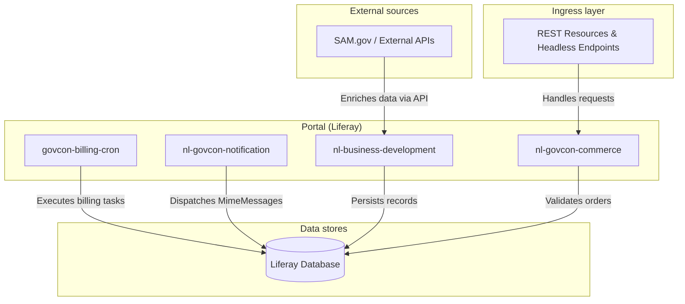

description: "Integrations architecture reference documenting modules, headless commerce services, notification channels, and enrichment cron tasks."

:::warning[INTERNAL]
This page is for engineering and operations. It documents internal services, extensions, and configurations without exposing credentials.
:::

## System overview

The GovCon360 integrations repository comprises modular Java components spanning business development, commerce delivery, notification dispatching, and asynchronous cron orchestration. Built primarily on Liferay OSGi modules, the platform exposes headless REST resources, scheduled task executors, and custom validation filters.

## Components and extensions

### Commerce and Billing Modules

| Component | Type | Friendly URL / Config | OAuth Scopes / Details |
| :--- | :--- | :--- | :--- |
| `GovConBillingConfigurationResource` | `CLASS` | `/com.govcon.billing.configuration` | Exposes billing configuration data via REST. |
| `DefaultCompanyBillingContactsResource` | `CLASS` | `nl.govcon.headless.commerce.delivery.order` | Manages company billing contacts with 14 key methods. |
| `DefaultCompanyBillingContractsResource` | `CLASS` | `nl.govcon.headless.commerce.delivery.order` | Manages subscription types and contract mappings. |
| `PlacedOrderByExternalReferenceCodeResource` | `CLASS` | `nl.govcon.headless.commerce.delivery.order` | Retrieves placed orders and items by external reference code. |
| `GovConBillingConfiguration` | `INTERFACE` | `Meta.OCD` / `ExtendedObjectClassDefinition` | Defines invoice due days and lead days configuration parameters. |
| `GovConBillingDispatchTaskExecutor` | `CLASS` | `com.govcon.billing.scheduler` | OSGi scheduled task runner for billing operations. |
| `InvoiceJob` | `CLASS` | `com.govcon.billing.scheduler` | Processes billing cycles, expando values, and contact additions. |
| `CommerceOrderCustomFieldsResolver` | `CLASS` | `nl.govcon.headless.commerce.admin.order` | Resolves custom field matches for commerce orders. |
| `CustomAvailabilityCommerceOrderValidatorImpl` | `CLASS` | `nl.govcon.commerce.order` | Validates order item availability against custom rules. |
| `CustomSubscriptionCommerceOrderValidatorImpl` | `CLASS` | `nl.govcon.commerce.order` | Validates custom subscription constraints during checkout. |
| `DefaultCompanyBillingContactsRequestFilter` | `CLASS` | `Provider` / `Component` | Filters requests for billing contacts and resolves admin user contexts. |
| `DefaultCompanyRequestFilter` | `CLASS` | `Provider` / `Component` | Intercepts default company requests. |
| `DefaultCompanyWriterInterceptor` | `CLASS` | `Provider` / `Component` | Intercepts outbound default company payloads. |
| `OrderAttachmentsWriterInterceptor` | `CLASS` | `Provider` / `Component` | Extracts full order metadata and attachment lists. |
| `OrderCustomFieldsFilter` | `CLASS` | `Provider` / `Component` | Rewrites and parses custom field clauses for order queries. |

### Business Development & Enrichment Modules

| Component | Type | Friendly URL / Config | OAuth Scopes / Details |
| :--- | :--- | :--- | :--- |
| `EnrichmentDebugResource` | `CLASS` | `nl.govcon.business.development.enrichment.debug` | Provides overview, health checks, filter states, and API bypass toggles. |
| `AccountRelationshipEnrichmentConfiguration` | `INTERFACE` | `Meta.OCD` | Configures cache TTL, refresh intervals, and API timeouts for accounts. |
| `CapabilityConfiguration` | `INTERFACE` | `Meta.OCD` | Configures add, update, and retry intervals for lead capabilities. |
| `ContactEnrichmentConfiguration` | `INTERFACE` | `Meta.OCD` | Configures contact enrichment intervals and cache TTL. |
| `EnrichmentConfiguration` | `INTERFACE` | `Meta.OCD` | Configures recompete refresh intervals. |
| `ProcurementNoticeEnrichmentConfiguration` | `INTERFACE` | `Meta.OCD` | Configures detail caching and procurement notice enrichment intervals. |
| `ProspectorCountsConfiguration` | `INTERFACE` | `Meta.OCD` | Configures evaluation group ERCs, new lead days, and SAM.gov thresholds. |
| `RecompeteEnrichmentConfiguration` | `INTERFACE` | `Meta.OCD` | Configures recompete API timeouts and refresh cycles. |
| `SamGovEnrichmentConfiguration` | `INTERFACE` | `Meta.OCD` | Configures SAM.gov API synchronization parameters. |

### Notification & Infrastructure Modules

| Component | Type | Friendly URL / Config | OAuth Scopes / Details |
| :--- | :--- | :--- | :--- |
| `EmailSenderConfiguration` | `INTERFACE` | `Meta.OCD` | Defines sender address, recipient limits, and attachment size caps. |
| `NlGovconNotificationConfiguration` | `INTERFACE` | `Meta.OCD` | Configures support emails and shared filter notification templates. |
| `NotificationConfig` | `INTERFACE` | `Meta.OCD` | Defines portlet views and redirect page URLs. |
| `ProvisioningJamesConfiguration` | `INTERFACE` | `Meta.OCD` | Configures connection parameters for the James mail service. |
| `GovConCommerceConfiguration` | `INTERFACE` | `Meta.OCD` | Configures admin slots and overage eligibility. |
| `DynamicSitemapEntityConfiguration` | `INTERFACE` | `Meta.OCD` | Configures entity type sitemap endpoints and payloads. |
| `SitemapConfiguration` | `INTERFACE` | `Meta.OCD` | Configures sitemap document folders and compression limits. |
| `CustomNotificationPortlet` | `CLASS` | `nl.notification.portlet` | Renders custom notifications via dynamic queries. |
| `DeleteNotificationActionCommand` | `CLASS` | `com.nl.notification.command` | Action command to delete user notifications. |
| `EmailNotificationServiceImpl` | `CLASS` | `nl.govcon.notification.core.internal` | Handles email notification dispatch and shared filter activation. |
| `EmailResourceImpl` | `CLASS` | `nl.govcon.notification.rest.internal.resource.v1_0` | REST endpoint for site email settings and outbound messages. |
| `EmailSenderServiceImpl` | `CLASS` | `nl.govcon.notification.core.internal` | Constructs MIME messages and delivers emails with permission checks. |
| `MarkAllNotificationsReadActionCommand` | `CLASS` | `com.nl.notification.command` | Marks all notifications read for the current user. |
| `MarkNotificationReadActionCommand` | `CLASS` | `com.nl.notification.command` | Marks a specific notification read. |
| `NlGovconUserNotificationDefinition` | `CLASS` | `nl.govcon.notification.core.internal.user.notification` | User notification definition component. |
| `NlGovconUserNotificationHandler` | `CLASS` | `nl.govcon.notification.core.internal.user.notification` | Resolves notification body text and deep-link URLs. |
| `NotificationConfigAction` | `CLASS` | `com.nl.notification.configuration` | Configuration action handler and JSP path provider. |
| `NotificationMvcActionCommand` | `CLASS` | `com.nl.notification.command` | General MVC action command for notifications. |
| `NotificationResourceImpl` | `CLASS` | `nl.govcon.notification.rest.internal.resource.v1_0` | REST API for retrieving, reading, and deleting notifications. |
| `UserNotificationServiceImpl` | `CLASS` | `nl.govcon.notification.core.internal.user.notification` | Manages user-specific notifications, unread counts, and persistence. |
| `TeamingPartnershipsPanelCategory` | `CLASS` | `nl.govcon.panel` | Contributes panel category keys and labels. |
| `JamesUserService` | `CLASS` | `com.portal.james.service` | Integrates with Apache James mail server for user provisioning. |

## Data and integration points

### Batch Definitions and Scheduled Tasks
- **Billing Cron (`GovConBillingDispatchTaskExecutor` & `InvoiceJob`)**: Operates on a scheduled interval to calculate billing cycles, inspect configuration thresholds via `GovConBillingConfiguration`, and provision contact records.
- **Enrichment Jobs**: Asynchronous background synchronization tasks driven by configurable intervals (`AccountRelationshipEnrichmentConfiguration`, `SamGovEnrichmentConfiguration`, `ProcurementNoticeEnrichmentConfiguration`) to pull data from external APIs into the portal database.

### REST and Headless Integration Points
- **Commerce Delivery Orders (`DefaultCompanyBillingContactsResource`, `DefaultCompanyBillingContractsResource`, `PlacedOrderByExternalReferenceCodeResource`)**: Exposed via headless endpoints under `nl.govcon.headless.commerce.delivery.order`, filtering orders by external reference codes and custom field rules.
- **Enrichment Debugging (`EnrichmentDebugResource`)**: Offers internal diagnostics, filter inspections, health metrics, and runtime API bypass toggles.
- **Notifications API (`EmailResourceImpl`, `NotificationResourceImpl`)**: Provides REST capabilities for querying notification pages, managing read statuses, and dispatching site-wide emails with attachments.
